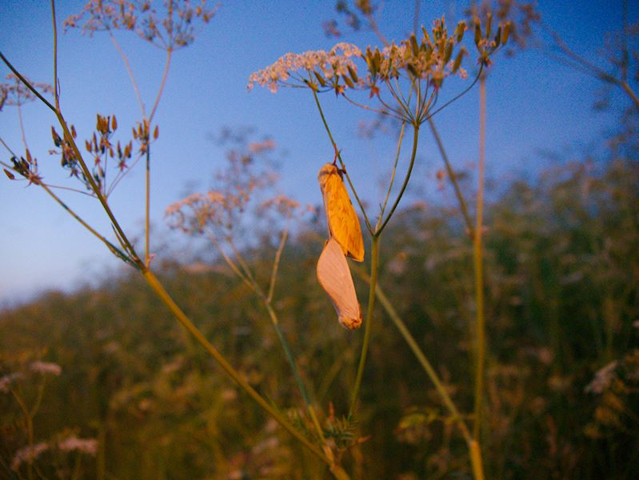
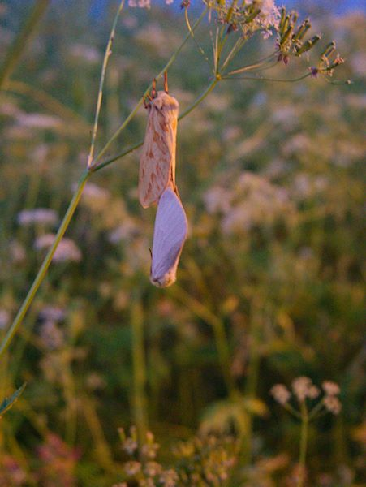
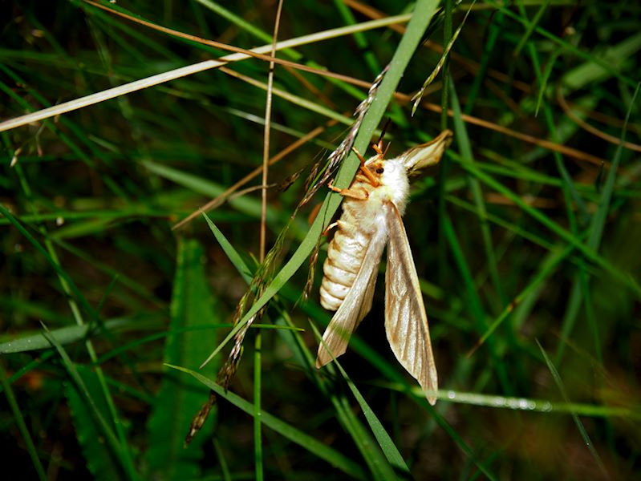
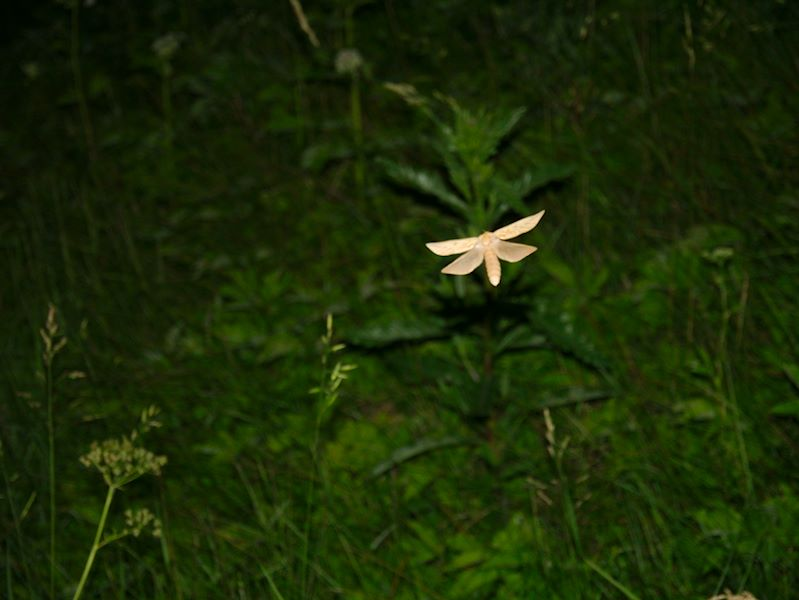
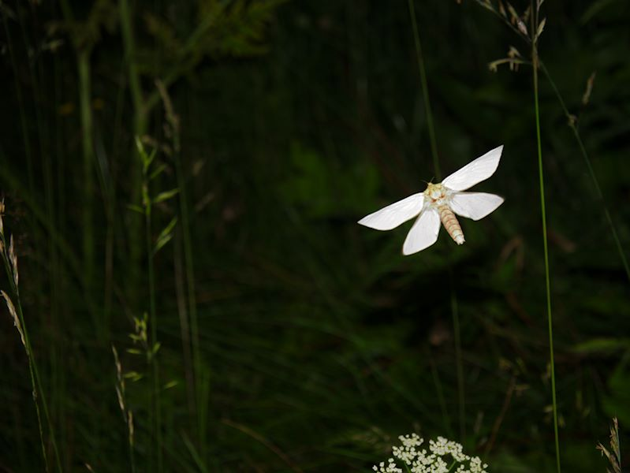

Yölaulajaretkillä onnistuu välillä lintujen lisäksi havainnoimaan muutakin luontoa. Vuosien saatossa on lintujen havainnoinnin ohessa tullut nähtyä ja kuultua peuroja/kauriita, kettuja, mäyriä, siilejä, sammakoita, niin ja tietysti myös hyttysiä. Muutama vuosi sitten eräällä yöretkellä huomasin sattumalta pyörätien poskessa liihottelevan vaaleita perhosia. Olin löytänyt humalaperhosyhdyskunnan ja päässyt niiden soidinlentoa seuraamaan. Oli alkuyö, ja tien piennar oli valtoimenaan muutaman sentin kokoisia vaaleita liihottelijoita, jotenkin aavemainen ja kiehtova näky. Humalaperhosen englanninkielinen nimi onkin ghost moth, eli "kummituskoi".

<figure>

https://youtu.be/vjQtXULlpYo

<figcaption>

Humalaperhoskoiraiden soidinlento - kuvattu puhelimella

</figcaption>

</figure>

<figure>

https://youtu.be/a0ujPe3B18k

<figcaption>

Parittelevat humalaperhoset - kuvattu puhelimella

</figcaption>

</figure>

Olen pari viime vuotta samoihin aikoihin pysähtynyt tuohon samaan paikkaan, ja ilokseni saanut seurata soidinlentoa juuri Juhannuksen tienoilla, näin myös tänäkin vuonna. Myös lokit ovat huomanneet humalaperhoset ;). Kova oli kala- ja naurulokkien yritys saada perhosia lennosta kiinni, aina välillä siinä onnistuenkin.

Kirjallisuudessa (internetissä) kerrotaan soidinkäyttäytymisestä mm.:

> Perhosen parittelukäyttäytymiseen liittyy parveilulento, jossa koiraat lentelevät iltahämärässä matalalla heinikon yläpuolella edestakaisin heijaten ja feromonia (tuoksuainetta) erittäen. Myöhemmin koiraat nousevat puun latvuksiin. Naaraat suunnistavat paikalle koiraiden tuoksujäljen ja valkoisten siipien heijastaman UV-säteilyn avulla. 
> 
> /via suomen-perhoset.fi

Löytämäni esiintymän lähellä ei ole puita laisinkaan, joten taitavat nousta vain koiranputkiin parittelemaan naaraiden kanssa.

<figure>

- <figure>
    
    
    
    <figcaption>
    
    Parittelevat humalaperhoset
    
    </figcaption>
    
    </figure>
    
- <figure>
    
    
    
    <figcaption>
    
    Parittelevat humalaperhoset
    
    </figcaption>
    
    </figure>
    
- <figure>
    
    
    
    <figcaption>
    
    Humalaperhonen - koiras
    
    </figcaption>
    
    </figure>
    
- <figure>
    
    
    
    <figcaption>
    
    Humalaperhonen - naaras
    
    </figcaption>
    
    </figure>
    
- <figure>
    
    
    
    <figcaption>
    
    Humalaperhonen - koiras
    
    </figcaption>
    
    </figure>
    

</figure>

Vaikeaa on yöllä ottaa edes jotenkin onnistuneita valokuvia kameralla, kännykälle on helpompaa. Gallerian kuvat järjestelmäkameralla.

Humalaperhonen on yleinen ja sen kanta elinvoimainen.  
Lisätietoa humalaperhosesta:

- [Humalaperhonen - Laji.fi](https://laji.fi/taxon/MX.58541)
- [Humalaperhonen - suomen-perhoset.fi](https://www.suomen-perhoset.fi/humalaperhonen/)
- [Humalaperhonen - Wikipedia](https://fi.wikipedia.org/wiki/Humalaperhonen)
