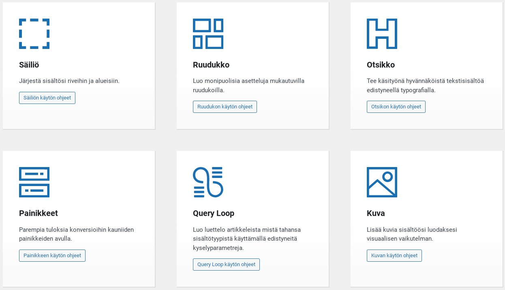

Gutenbergin korvatessa WordPressin Classic Editorin, mullistui sisällöntuotanto merkittävästi. WordPress versiosta 5 lähtien on ollut mahdollista käyttää uutta Gutenbergia, mutta useilla sivustoilla eletään vielä vanhalla Classic Editor -aikakaudella. Vuoden 2022 lopulla on melko varmaan tämä siirtymävaihe tullut loppuunsa kun Classic Editorin tuki näyttäisi vihdoin (ehkä) loppuvan.

> Classic Editor is an official WordPress plugin, and will be fully supported and maintained until at least 2022, or as long as is necessary.  
>   
> /via WordPress.org News

On siis siirryttävä Gutenbergin käyttöön.  
Toki osalla WordPress -sivustoja on Classic Editorin rinnalla ollut käytössä ns. Page Buildereita kuten Elementor, Site Origin, Beaver Builder jne., joilla ominaisuuksiltaan rajoittunut peruseditori Classic Editorin on korvattu. Jatkossa siis itse peruseditori on [Gutenberg](https://wordpress.org/gutenberg/), tarvitaanko siinä sitten enää apuna Page Buildereita?

Gutenberg on selvästi monipuolisempi kuin Classic editor ja hyvä niin, kehitys kehittyy ;)  
Gutenbergin sisään rakennetut lohkoelementit ovat mainioita, ja ominaisuuksiltaan ovat kehittyneet edelleen paremmiksi ja monipuolisemmiksi. Gutenberg siis jo perusominaisuuksiltaan vie pohjaa pois käyttää erillistä Page Builderia, kun uudemmalla Gutenbergilla itsellään saa jo paljon aikaiseksi.  
Silti, perusominaisuuksiltaan Gutenbergin lohkot ovat melko yksinkertaisia ja näin tilaisuus on avoinna kolmannen osapuolen tarjoamille monipuolisemmille lohkoille.  
Itse käyttämäni laajennuskeino perus Gutenbergiin on käyttää siinä rinnalla erinomaista GenerateBlocks -lisäosaa. [GeneratePress -teema](https://wordpress.org/themes/generatepress/) ja [GenerateBlocks -lisäosa](https://wordpress.org/plugins/generateblocks/) (sama tekijä) ovat yhdessä erinomainen ketterä Page Buildereitten korvaajakaksikko, sillä yhteenlaskettu ominaisuussetti on riittävän kattava useimmille sivustoille. Sekä em. teemasta että lisäosasta on tarjolla sekä maksuttomat että maksulliset premium/pro -versiot.

## GenerateBlocks lohkojen ominaisuuksia

Kirjoitushetkellä Generate Blocks tarjoaa sisällöntuottajalle kuusi omaa uutta lohkoa Gutenbergiin.

- **Säiliö - Container**  
    Säiliölohko on lisäosan ydinlohko. Sen avulla voit luoda edistyneitä (tai yksinkertaisia) alueita sisällöllesi.  
    [Tutustu ominaisuuksiin dokumentaatiosta](https://docs.generateblocks.com/article/container-overview/?utm_source=teuvovaisanen.fi&utm_medium=affiliate&utm_campaign=blog)
- **Ruudukko - Grid**  
    Ruudukkolohkon avulla voit rakentaa edistyneitä sarakkeita (palstoja) sisältöösi. Se käyttää teknisesti flexboxia ja mahdollistaa jopa sarakkeiden käärimisen useille riveille, mikä tarkoittaa, että voit jatkaa sarakkeiden lisäämistä ikuisesti luodaksesi monirivisiä ruudukoita.  
    [Tutustu ominaisuuksiin dokumentaatiosta](https://docs.generateblocks.com/article/grid-overview/?utm_source=teuvovaisanen.fi&utm_medium=affiliate&utm_campaign=blog)
- **Otsikko - Headline**  
    Otsikkolohko on ihanteellinen otsikoille, toimintakehotuksille tai yhden rivin ominaisuuksille.  
    [Tutustu ominaisuuksiin dokumentaatiosta](https://docs.generateblocks.com/article/headline-overview/?utm_source=teuvovaisanen.fi&utm_medium=affiliate&utm_campaign=blog)
- **Painikkeet - Buttons**  
    Painikkeet lohkon avulla voit lisätä sivulle yhden tai useampia painikkeita.  
    [Tutustu ominaisuuksiin dokumentaatiosta](https://docs.generateblocks.com/article/buttons-overview/?utm_source=teuvovaisanen.fi&utm_medium=affiliate&utm_campaign=blog)
- **Query Loop**  
    QueryLoop -lohko mahdollistaa sisältöjen näyttämisen määritettyjen kyselyparametrien perusteella; kuin PHP-silmukka mutta ilman koodia.  
    [Tutustu ominaisuuksiin dokumentaatiosta](https://docs.generateblocks.com/article/query-loop-overview/?utm_source=teuvovaisanen.fi&utm_medium=affiliate&utm_campaign=blog)
- **Kuva - Image**  
    Kuvalohkon avulla voit lisätä kuvan sivustollesi. Verrattuna WP-ydinkuvalohkoon GB:n kuvalohko tarjoaa dynaamisia vaihtoehtoja ja lisää mukautusvaihtoehtoja.  
    [Tutustu ominaisuuksiin dokumentaatiosta](https://docs.generateblocks.com/article/image-overview/?utm_source=teuvovaisanen.fi&utm_medium=affiliate&utm_campaign=blog)

GenerateBlocks -lisäosan englanninkielisten ohjeiden mukaan pääsee hyvin jyvälle lohkojen ominaisuuksista osoitteessa [https://docs.generateblocks.com/](https://docs.generateblocks.com/?utm_source=teuvovaisanen.fi&utm_medium=affiliate&utm_campaign=blog) ja näiden lisäksi tarjolla on myös [Youtube -kanava](https://www.youtube.com/c/GenerateBlocks?utm_source=teuvovaisanen.fi&utm_medium=affiliate&utm_campaign=blog), jossa helposti seurattavia englanninkielisiä opetusvideoita.

Itse lisäosahan on käännetty myös suomeksi ;)

Tälle lisäosalle on minulta lämmin suositus!
