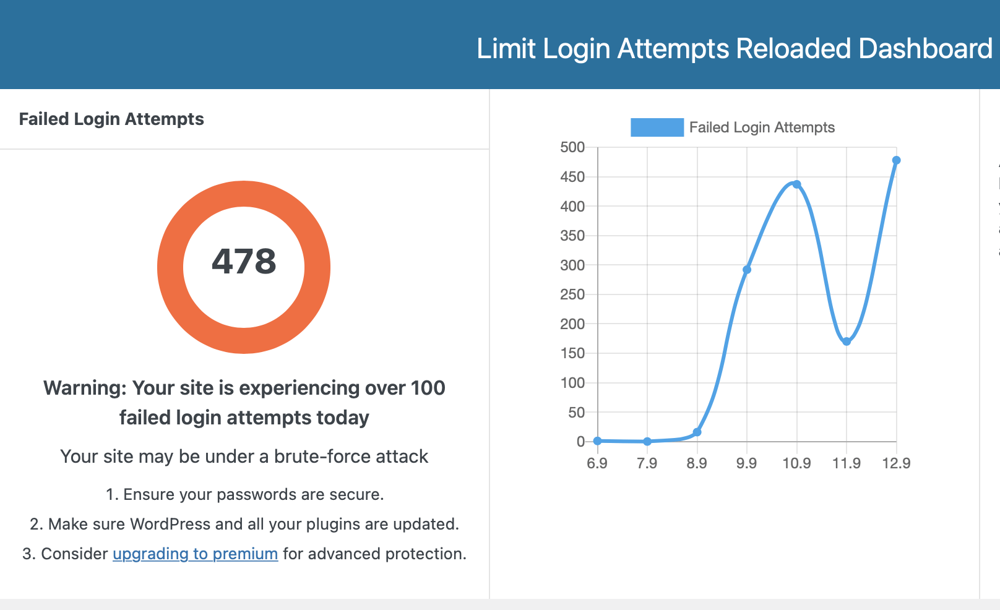
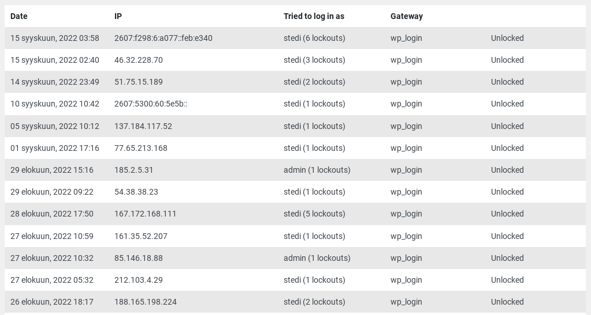
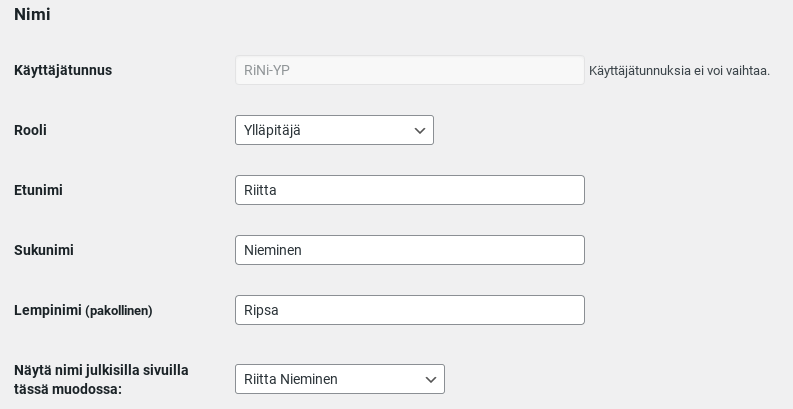

Murtoyritykset WordPress -sivustoille ovat arkipäivää olipa sivusto sitten "merkityksellinen yrityssivusto" tai "taviksen blogi", kaikki kelpaavat murtokohteeksi. Robottiarmeijja yrittää jatkuvasti kirjautua sivustoille arvaamalla käyttäjätunnusta ja salasanaa, kone on väsymätön yrityksissään. Brute Force Attacks on termi näille yrityksille.

Tälläisiä sisäänkirjautusmisyrityksiä vastaan on olemassa lisäosia, jotka tarkkailevat yrityksiä ja mm. blokkaavat yrittäjän IP-osoitteen joksikin aikaa liian monen yrityksen jälkeen. Omalla sivustollani on käytössä [Limit Login Attempts Reloded](https://wordpress.org/plugins/limit-login-attempts-reloaded/) -lisäosa, jonka lokia seuraamalla on "hauska" tarkastella murtoyritysten epäonnistumisia. Yrityksiä on päivittäin pahimmillaan jopa satoja. Alla oleva kuva on asiakkaani sivuston tietoja.

Oman sivustoni murtoyritysten lokia tarkastelemalla olen huomannut, että näissä yrityksissä käyttäjätunnuksena käytetään yleisimmin lempinimeäni **Stedi**. Mistä murtautujat ovat sen keksineet?

## Älä käytä helposti arvattavaa käyttäjätunnusta

Jo alkuvaiheessa, kun luodaan sivustolle käyttäjätunnuksia, tulisi huolehtia siitä, ettei valita käyttöön liian helposti arvattavaa tunnusta kuten esim. etunimeä. Käyttäjätunnustahan ei voi jälkikäteen vaihtaa, joten tämä on mietittävä siis jo aivan alkuvaiheessa.

WordPressin käyttäjäprofiilissa voi kukin käyttäjä kertoa itsestään tietokenttiin täydentämillään tiedoilla. **Älä siis käytä käyttäjätunnuksena mitään kolmessa nimikentässä olevia tietoja**. Valitse siis myös alimpaan vaihtoehtoon sellainen versio, joka ei paljasta käyttäjätunnusta.

Tämä alin kenttähän on se tieto, joka merkitään mm. artikkeliin kirjoittajaksi. Se tulee usein näkyviin artikkeleihin automaattisesti. Omalla sivustollani olen merkinnyt kirjoittajaksi lempinimeni, joten sieltähän ne murtoyrittäjät sen ovat poimineet. Mutta eihän minulla tietenkään ole se käyttäjätunnuksena, joten valtaosa murtoyrityksistä tyssää jo tähän simppeliin kikkaan.

Mutta murtoa yritävät pahulaiset saavat helposti selville kirjautumistunnuksen myös vain katsomalla sen sivustolta liittämällä selaimeen sivuston osoitteen perään parametrit tähän tapaan: [https://teuvovaisanen.fi/?author=1](https://teuvovaisanen.fi/?author=1)  
Jokainen käyttäjätunnus on "numeroitu", joten voi olla vaikka ?author=7, testaa vaikka omalla sivustollasi.

Tämän tunnuksien haistelun estäminen onnistuu eri tavoin, koodilla tai lisäosilla. Mikäli käytössäsi on lapsiteema, on sen functions.php oikea paikka räätälöidyn koodi upottamiseen. [Täällä on muutama hyvä esimerkki toteuttamiseen](https://www.optimumcreative.com/disable-author-archive-author-page-or-author-url-in-wordpress/).

Yksinkertainen keino on myös siirtää (piilottaa) sisäänkirjautumissivu. Normaalisti sisäänkirjautuminen on osoitteessa /wp-admin/ mutta sen voi muuttaa miksi haluaakaan, vaikkapa /kukkuu/ .  
Helpoiten tuon muuton tekee maksuttomalla lisäosalla [WPS Hide Login](https://wordpress.org/plugins/wps-hide-login/).

No saattaahan robotti arvata ennen pitkää kuitenkin sen oikean kombinaation, joten minulla on vielä kaksivaiheinen todentaminen apuna sisäänkirjautumisessa. Näiden parin kolmen tietoturvakeinon yhdistelmä on varmaan riittävä esto Brute Force Attack -yrityksille ainakin omalle sivustolleni.
