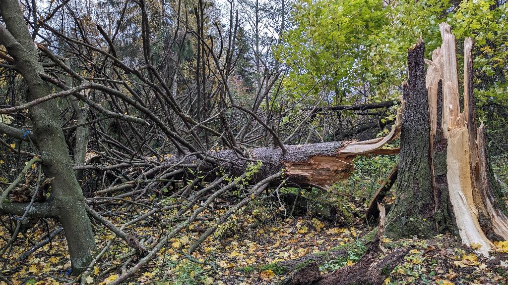
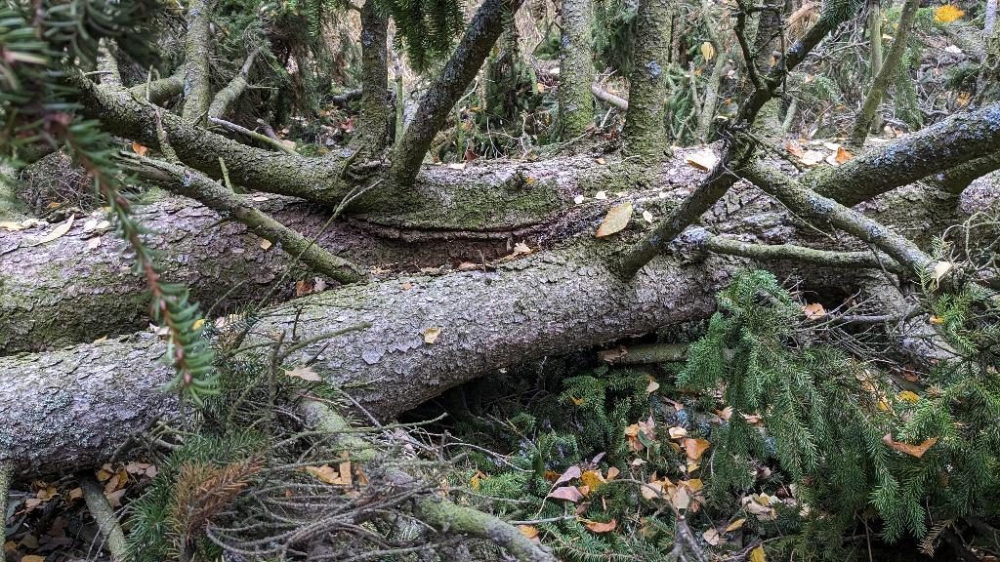
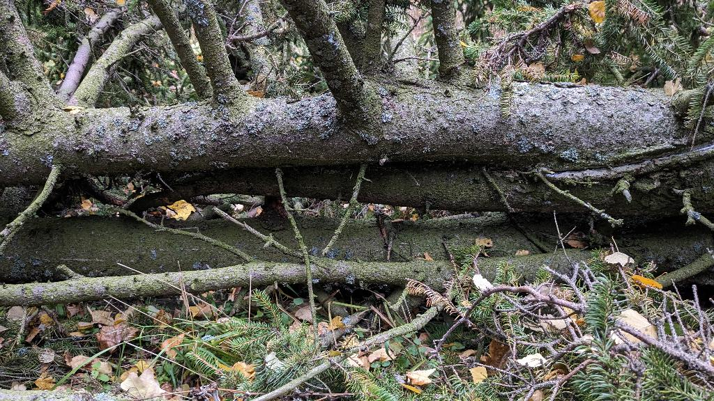

Viimeaikaisissa reippaissa tuulissa oli eräs lähistön kuusista kaatunut. On siinä käynyt melko rytinä, sillä iso puu se oli. Mittasin reippaan kokoisilla askelilla, 26 askelta pitkä.

Isokokoinen kuusi ja sen säpäleinen kanto

  
Kuusi oli erikoinen, sillä oli monta latvaa. Ehkä noin puolimatkassa se haaraantui. Olisiko salama joskus iskenyt? Jotenkin haarautumisjälki näytti sellaiselta.

Kuusi haarautuu, olisiko salama aikoinaan iskenut?

  
Toinen haara kasvoi suhteellisen normaalin näköisenä, mutta tiheänä. Toinen sen sijaan haarautui jatkossa latvaa kohti useamman kerran siten, että yläosassa oli ainakin viisi erillistä latvaa melkoisen tiheänä kasvustona.

Kuusella oli monta latvaa

  
Lähistöllä on muitakin kuusia, joilla on useampia latvoja. Toisilla lisälatvat alkavat kasvamaan oksista jo melko alhaaltakin.
