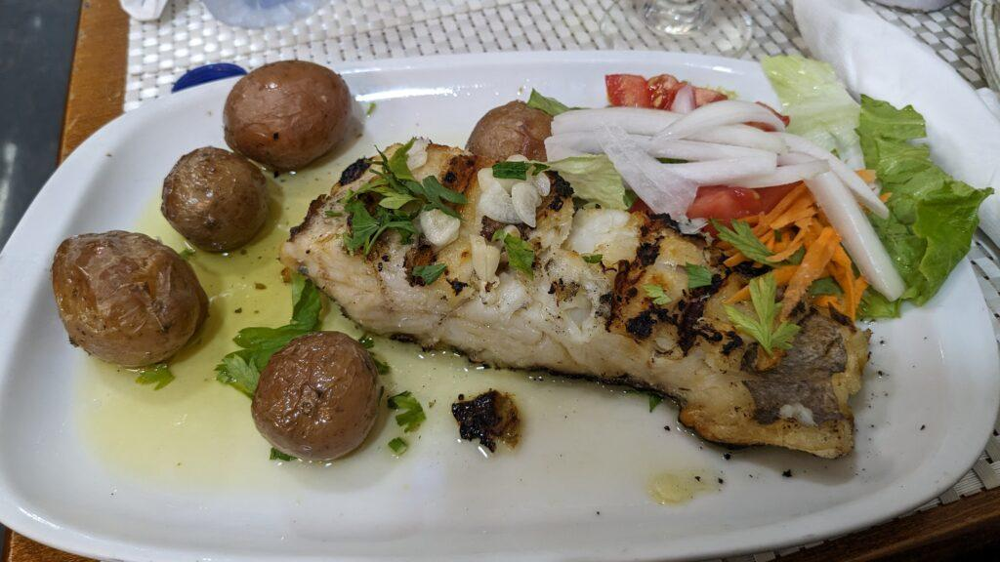
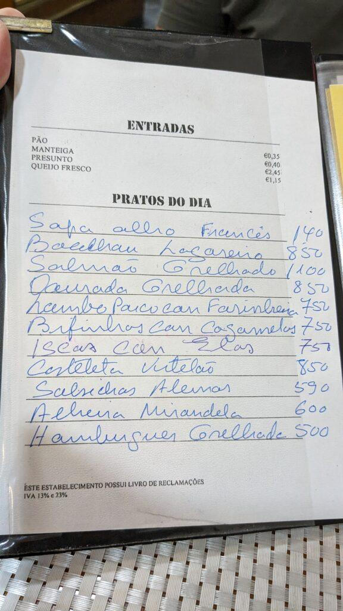
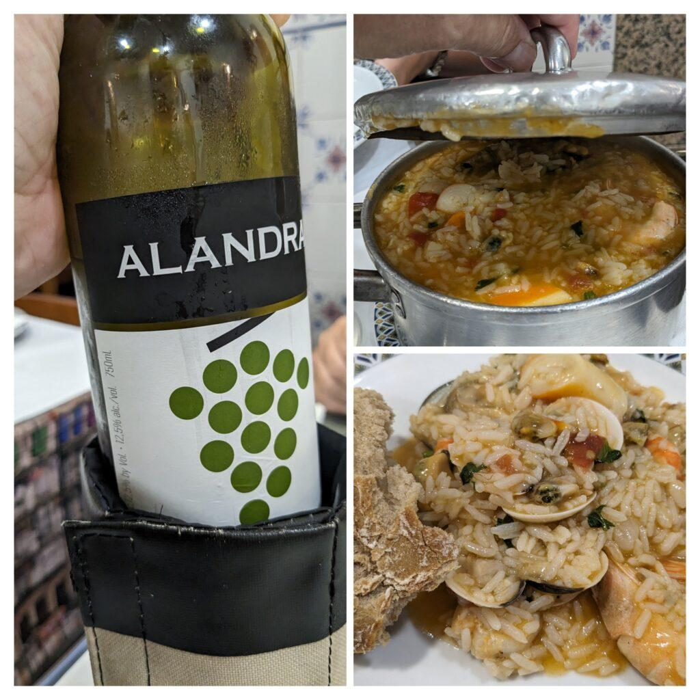
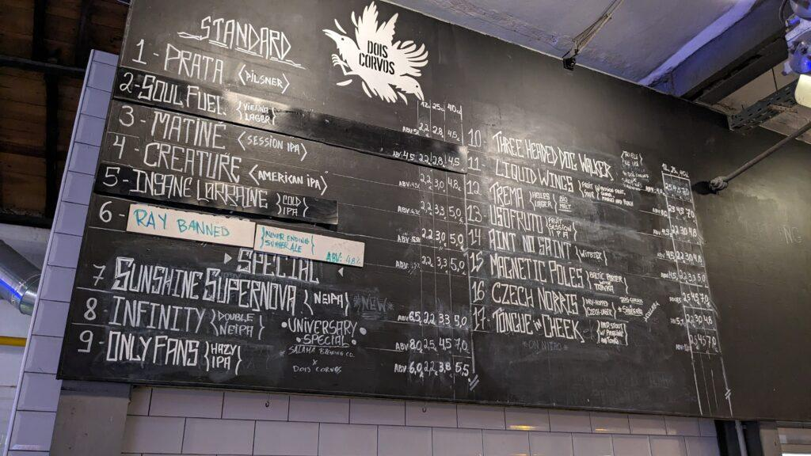
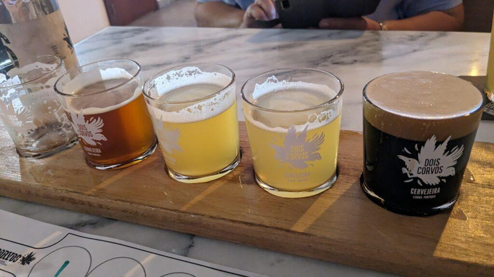

Hieman jo äimistyneenäkin totesimme vaimoni kanssa äskettäin, että olemme vierailleet Lissabonissa nyt jo yhdeksän kertaa. Portugalissa yksitoista kertaa, kun 1980 -luvulla vierailimme Albufeirassa ja 2010 -luvulla myös Madeiralla. Melkeinpä 12 kertaa, jos laskisi mukaan Kap Verden vierailun, sehän on entinen Portugalin ns. "alusmaa".

Mikä meitä sinne vie aina uudestaan ja uudestaan?  
Ihmiset siellä ovat ystävällisiä eivätkä liian päälletunkevia, yksityisyyttä kunnioittavia. Heissä on jotain samaa kuin meissä suomalaisissa. Tämä on varmaan yksi syy. Olo ja elo siellä on jotenkin kotoista ja leppoisaa. Nämä tuntemukset ovat tekemiltämme 4-10 päivän pituisilta reissuilta.

Osa vetovoimasta on tietty myös ruoalla, juomalla sekä niiden hintatasolla. Suomalaisen kukkarolle melkoisen mukavaa on kun esimerkiksi kahvilassa espresso on 80 senttiä ja makean leivonnaisen saa kylkeen yhdellä eurolla. Useasti pikainen kahvilakäynti kahdelta hengeltä on alle neljä euroa. Tavallisessa paikallisessa ravintolassa lounasannokset ovat alle kympin. Onhan siellä tietty kalliimpiakin kahviloita ja ravintoloita, yleensä pääruoat kuitenkin alle kaksi kymppiä hienommissakin. Muhkeat aamupalasämpylät naapuruston leipomomyymälästä 24 centtiä kappale.  
Perushintataso on selkeästi alempi kuin Suomessa.

Sääkin on suomalaiselle mukava, kunhan valitsee ajankohdan oikein. Useimmiten syys-lokakuun vaihde on hyvä, lämpötilat viime reissulla olivat 20-28 välillä tuohon syysaikaan.

Meitä on Lissaboniin vetää tietty myös hauskat pienet muistot edellisistä reissuista. Meillä on leikillinen lista juttuja, jotka kuuluvat jo vierailuilla traditioon. Tietyt ravintolat on käytävä uudestaan ja tietyt kaupat on käytävä ym.

## Suosikkejamme

### Kahvikauppa (jota ei enää ole) ja sen herrasmiemyyjä

Keskustassa eräällä turistikadulla oli kahvi/teekauppa, jossa vierailimme ensivisiitillämme. Siellä oli myyjänä vanha harmaapäinen kohtelias herrasmies. Häneltä ostimme kahvia. Hän jauhoi kaupassa vanhalla jauhimella pavut ja sitten alkoi näytös. Hän osasi pakata kahvin niin hienoon pakettiin pieteetillä taittaen pussin reunat nätisti ja teipaten sen kauniisti. Tuo pieteetillä pakkaaminen oli lumoavaa katsella. Sen pakkaamistapahtuman takia palasimme kauppaan aina uudelleen ja uudelleen. Ehkä hassua, mutta meille se oli se juttu. Harmi, kun kauppaa ei enää ole mutta kokemus on vahvana muistoissa.

### Tavallinen kahvilaravintola ja sen ystävällinen herrasmiestarjoilija

Toinenkin suosikkimme liittyy henkilöön. Olimme haahuilemassa Lissabonin Stokkalla eli El Corte Inglés -tavaratalossa. Sieltä poistuessamme oli kova nälkä. Aivan tavarataloa vastapäätä oli pieni kahvilaravintola, siispä sinne. [Snack-bar O 120](https://goo.gl/maps/gdbHCSnBA7Uz5XAK8). Nimi ei luvannut paljoa eikä ehkä interiöörikään, ravintola kun on puoliksi katutason alapuolella ja vaatimaton sisustukseltaan. Henkilökunnasta meidät otti hoitaakseen vanhempi harmaapäinen herrasmies, ei osannut englantia kuin muutaman sanan. Ruokalista käsin kirjoitettu portugaliksi. Ei hätää. Tämä ihana vanha herra osasi kyllä jotenkin meille selittää ruuat: fish , meat jne. ja pitää meistä hyvää huolta koko vierailun ajan. Olemme sen jälkeen vierailleet siellä joka kerta ja vain oikeastaan tuon herran takia. Toki ruokakin on ollut hyvää mutkatonta lounasruokaa, asiakkaina selvästi paikallisia lähistöllä työskenteleviä. Kahteen viime kertaan häntä ei ole enää näkynyt, emmekä ole kehdanneet kysyä mitä hänelle kuuluu, muuten tuttuja hahmoja siellä edelleen on töissä.

Turskaa, tyypillinen yksinkertainen lounasannos

Ruokalista ja hinnat

### Parturi

Minullahan tukka ei enää kaikkialla kasva, olenkin vuosikausia itse ajanut koneella sen lyhyeksi mikä kasvaa ja vaimo on siistinyt loput. Nyt olin reissulle lähtenyt liian biitlesringona, joten päätin mennä parturiin. Niitähän siellä riittää. Aiemmista vanhemmista herrasmieskokemuksista päättelin, että jospa löytäisin parturin jostain sivummalta ja jos vielä siellä olisi vanhempi herra leikkaamaassa, niin olisiko siinä jotain taikaa kuten edellisissäkin vanhojen herrojen paikoissa. Ja löysinkin vanhan herran parturin aivan majapaikkamme läheltä, eikun sisään. Ei englantia taitanut hän, mutta ei haittaa, elekieli on kansainvälinen :) Ja kyllä, taikaa oli tässäkin harmaapäisessä herrassa. Ihanaa käsityötä sai taas seurata läheltä.  
Parran lyhennys koneella ja viimeistely saksilla, partabalsami. Korvakarvat ja nenäkarvat sekä kulmakarvat. Tukan lyhennys koneella ja viimeistely saksilla. Lopuksi pesu, kuivaus. 20€ hela hoito.  
Menen sinne varmasti uudestaan ensi kerralla. Toivottavasti tämä herra on vielä ensi kerralla siellä.

### Kilikoliravintola ja portugalilainen äyriäisriisi

Arroz de Marisco kuuluu jokaiseen vierailuun ja sen nautimme aina [Príncipe do Calhariz](https://g.page/principedocalhariz?share) -ravintolassa, jota kilikoliravintolaksi kutsumme. Nimi tulee äänimaisemasta, joka ravintolassa on. Se on usein lähes täynnä paikallisia ihmisiä lounastamassa ja meteli on sen mukainen. Siellä käy aikamoinen sutina. Äyriäisriisi tarjoillaan klommoisista kattiloista ja se on herkullista. Viimeksi 12€ per henkilö ja valkoviinipullo 15€.

Pullo valkoviiniä ja kattilallinen äyriäisriisiä

### Olutpanimoravintola lintumiehelle

Portugalia ei pidetä mitenkään perinteisenä olutmaana, mutta viime vuosina se on sellaiseksi tullut. Bulkkiolutmerkkejä on siellä kaksi isoa, [Sagres](https://www.centralcervejas.pt/pt/) ja [Super Bock](https://www.superbock.pt/en/). Ihan jepu janojuomia heidän laakerinsa. Pienpanimoita on viime vuosina tullut useita mm. [Oitava Colina](https://www.oitavacolina.pt/), [Duque Brewpub](https://www.duquebrewpub.com/) ja suosikkini [Dois Corvos](https://www.doiscorvos.pt/en/) eli kaksi korppia. Nykyään vierailemme aina Dois Corvosin panimoravintolassa.

Dois Corvos ja oluttarjonta

Lissabon, kummallinen tunne, ihan kuin kotiinsa tulisi.
