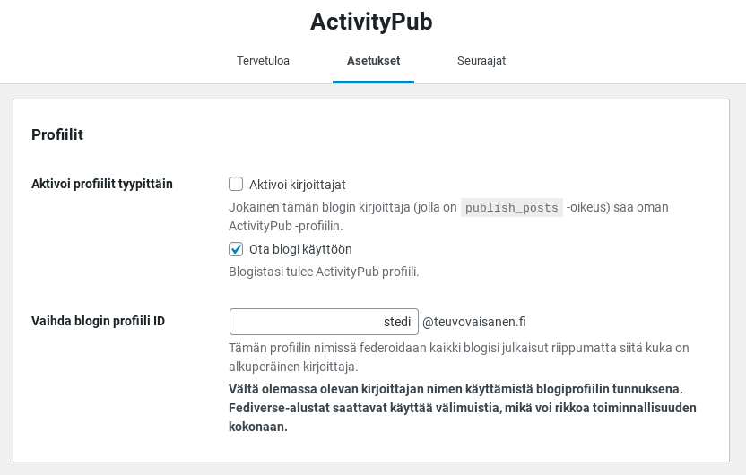
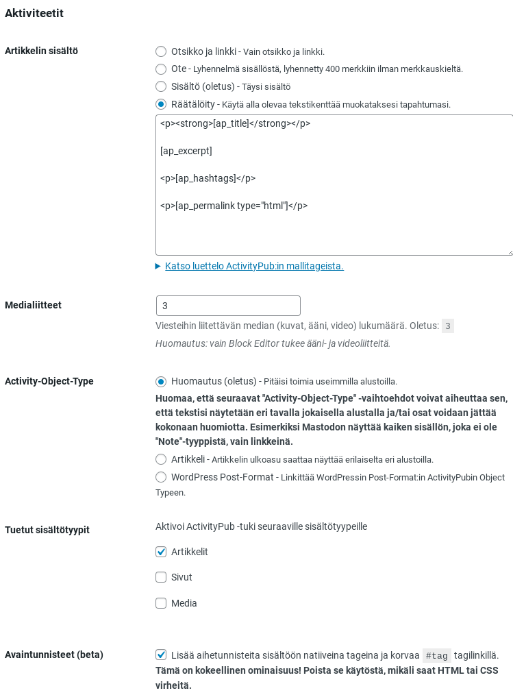

Mikä ihme se Fediverse tai Fediversumi oikein on?  
Ihan omin sanoin yksinkertaisesti: Fediversumi on sosiaalisten verkkopalvelujen verkosto.  
Hienompi määritelmä englanniksi: [https://en.wikipedia.org/wiki/Fediverse](https://en.wikipedia.org/wiki/Fediverse)  
Niissä Fediversumin palveluissahan on jo useita miljoonia käyttäjiä, potentiaalisia lukijoita.  
Miksi en siis laittaisi WordPress -sivuston kirjoituksia automaattisesti julkaistumaan Fediversumiin?  
Näin helposti se tehdään.

1. Siirry WordPress sivuston ylläpidon puolelle (ylläpito-oikeuksin) ja asenna lisäosa ActivityPub  
    https://fi.wordpress.org/plugins/activitypub/  
    

3. Ota lisäosa käyttöön.  
    Asennuksen ja käyttöönoton jälkeen lisäosa löytyy täältä:  
    **Ohjausnäkymä - Asetukset - ActivityPub**  
    

5. Lisäosalla on kolme välilehtinäkymää: **Tervetuloa**, **Asetukset** ja **Seuraajat**  
    Tee asetuksiin haluamasi muutokset, tuon näkymän ohjeet melko hyvin opastavat käyttöönotossa. Kts. ruutukaappaukset alempana.  
    Tallenna asetukset  
    

7. Siirry Fediversumiin, esim. Mastodoniin ja ota uusi juuri tekemäsi blogin profiili siellä seurantaan.  
    

9. Siirry WordPressiin ja tee artikkeli. Melkein välittömästi näet Fediversumissa kirjoituksesi julkaistuna omalla aikajanallasi muiden seurattujen profiilien joukossa.  
    

11. Sillä sipuli.  
     Sivustollesi kannattaa laittaa blogiprofiili tilattavaksi samaan tapaan kuin RSS -syöte, jotta lukijasi ottaisivat sen seurantaan. Siis markkinoi blogiprofiiliasi! Laita se vaikka Mastodonissa profiilisi linkkikokoelmaan näkyville jne.  
     

**ActivityPub - Asetukset - Profiilit**  
Tässä kuvassa olevissa asetuksissa kaikki blogin käyttäjät näkyvät saman profiilinimen takaa "anonyymeinä"

**ActivityPub - Asetukset - Aktiviteetit**

Voit määrittää mallitägien avulla miten julkaistu artikkeli näkyy Fediversumissa.  
  
Muista kirjoittaa myös Ote -kenttään fiksut tekstit ( kirjoitusnäkymässä Artikkeli -Ote)

Ehdottomasti kannattaa käyttää aihetunnisteita, sillä ne näyttävät toimivan hienosti suoraan Fediversumissa linkkeinä.
