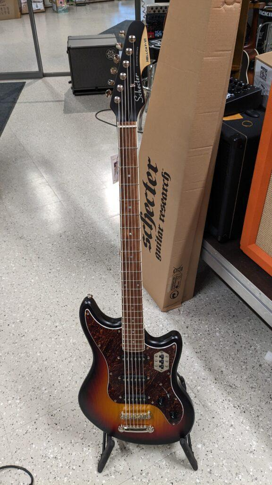
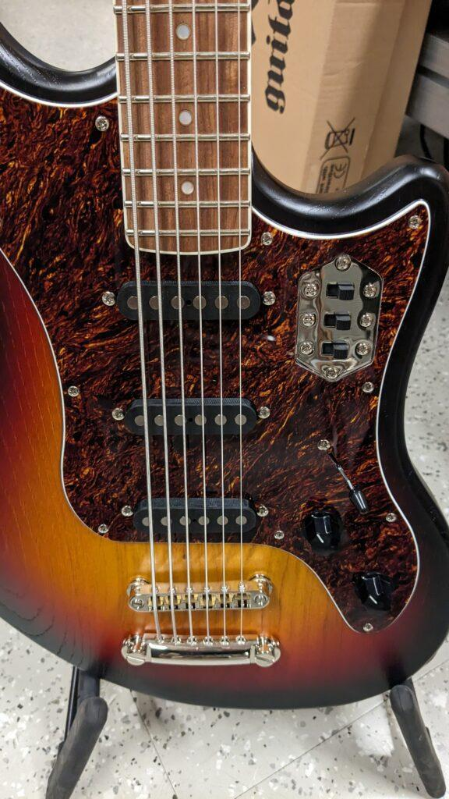
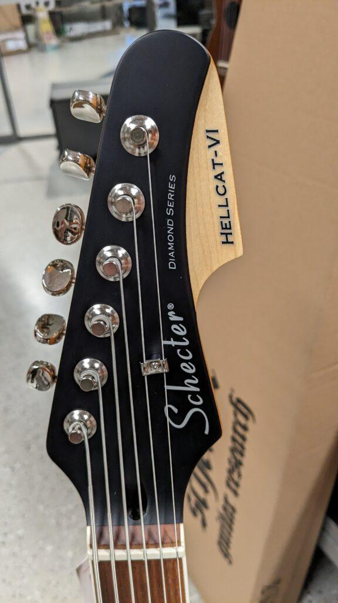
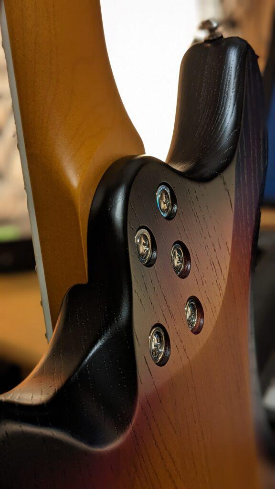
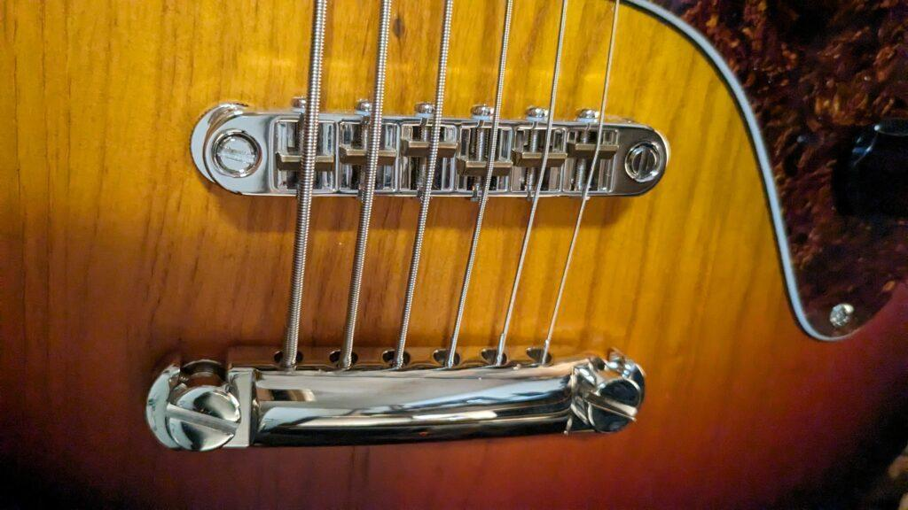
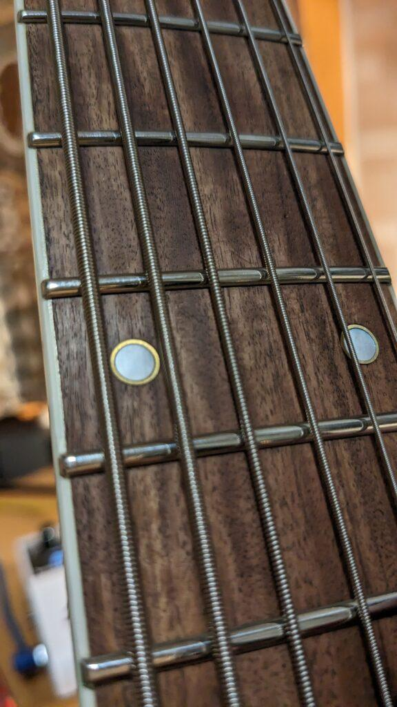

Bass VI -tyyppinen soitin on omanlaisensa hybridi soitin, sitä voi soittaa kuin bassoa ja ottaa sointuja kuin kitaralla. Kuusi kieltä samaan tapaan viritettynä kuin kitarassa, vaan oktaavi alempana, siis basson äänialalla.

Bass VI -tyyppiset soittimet olivat etenkin 60 -luvulla suosittuja ja melko yleisesti käytössä.  
Beatlesissa kun McCartneyllä oli muuta puuhaa vaikkapa pianon parissa, niin Harrison tai Lennon soitti bassot Bass VI:lla.  
Cream - yhtyeen basisti Jack Bruce soitti ekalla levyllä (Fresh Cream) Bass VI -bassoa.  
Cure -yhtyeessäkin soitin on käytössä.  
Bass VI oli myös aikoinaan jo 50 -luvulla yleisesti tuplaamassa kontrabasson ääntä, jotta siitä tulisi erottuvampi (tic-tac bass).

Bass VI -tyyppisiä soittimia on tarjolla useammallakin kitaramerkillä , mm. Danelectro, Fender, Squier, Eastwood ja Schecter. Paljon tutkin etukäteen Youtuben arkistosta eri Bass VI -versioita ja niiden arvosteluja sekä ääninäytteitä, sillä kovasti tykästyin soittimeen, kyllä sellainen piti saada.

Päädyin Schecteriin. Suomestahan sitä ei suoraan mistään saanut, mutta Soundtools Helsingin Elimäenkadulla ([https://soundtools.fi/](https://soundtools.fi/)) ystävällisesti minulle sellaisen jenkeistä tilasi. Sain vielä hyvällä ehdolla, sillä ei ostopakkoa, jos koesoiton perusteella en olisikaan tyytyväinen. Todella reilua!  
No tänään 21.11.2023 olin koesoittamassa sillä seurauksella, että bassokitara on nyt kotona :) Mielenkiintoisia hetkiä edessäpäin.

Nyt minulla on kolme erityyppistä sähköbassoa, normaali 34" nelikielinen, lyhytkaulainen 30" nelikielinen sekä nyt siis 30" kuusikielinen. Kaikille on omat lokosensa minun musiikkimaailmassani.

Schecter Hellcat-VI - lisätietoja [https://www.schecterguitars.com/Hellcat-Vi](https://www.schecterguitars.com/Hellcat-Vi)
