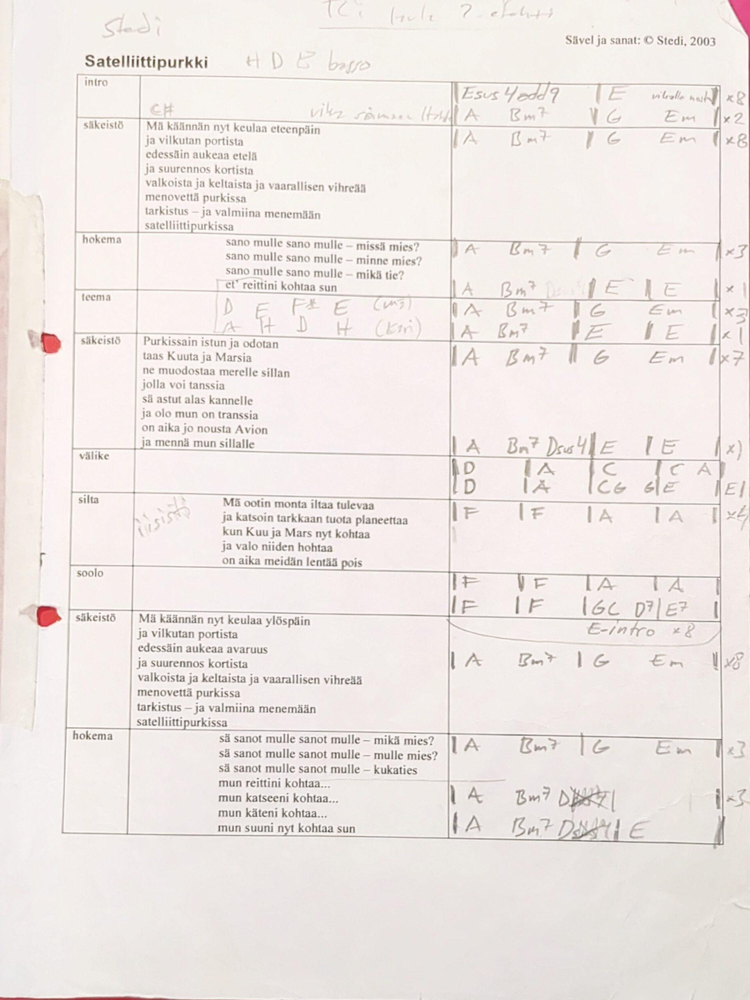
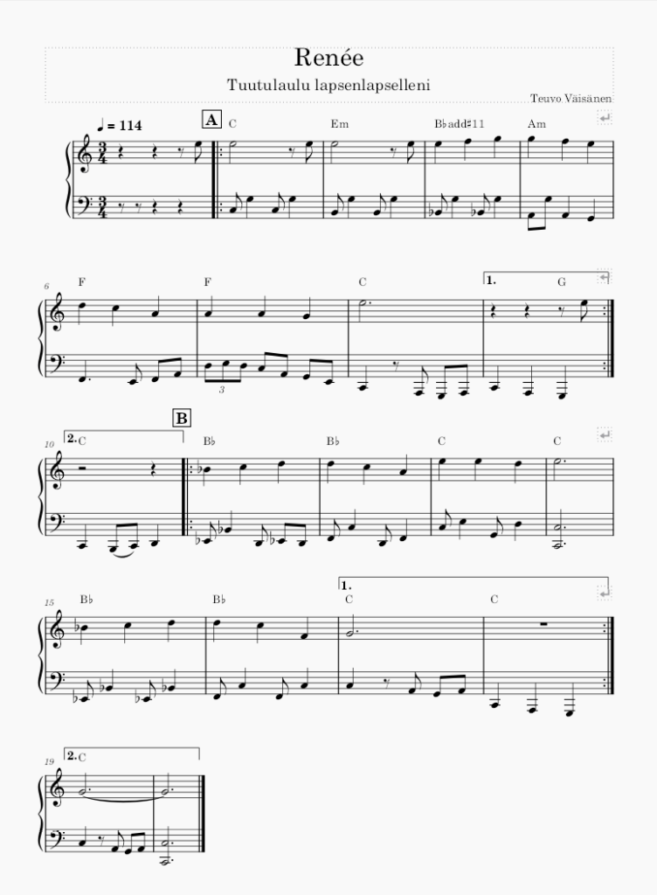

En osaa nuotteja, tai siis en osaa soittaa nuoteista muuta kuin hitaasti tankkaamalla, merkki merkiltä. Eihän nuottikirjoitusta tarvitakaan soittamisessa, kaiken voi opetella ulkoa, onneksi. Nuotit on muistiinpanoväline.

En mitenkään väheksy nuottikirjoitusta, itse en vaan sitä ole tarvinnut paljonkaan. Tavallisessa rokkibänditouhussa ei nuottikirjoituksella ole juuri tarvetta, biisit ja niiden rakenteet opetellaan yleensä ulkoa tai sitten käytetään apuna jotain simppeliä rakennemuistiinpanoa. Nämä rakennemuistiinpanot yleensä riittävät, melodiat ja riffit sekä aksentit jne. yritetään muistaa ulkoa.

Ei noilla "bändin sisäisillä" rakennemuistiinpanoilla kuitenkaan voi koko biisiä laittaa muistiin, melodia ja mahdolliset stemmat puuttuu. Niitä voi toki tabulatuurimerkinnöin taltioida, jos ei halua nuotteja käyttää.

## MuseScore nuotinnossovellus

Nuottikirjoitus on kuitenkin paras, jos koko biisi täytyy tallentaa "paperille" muistiin, jotta joku muu pystyisi sen sitten kenties soittamaan. Olen ottanut itseäni niskasta kiinni ja opetellut kirjoittamaan nuotteja käyttäen maksutonta MuseScrore -sovellusta. Hitaasti oppi etenee, onneksi saan apua bändimme kitaristilta, hän kun säveltelee kaikenlaista koko ajan MuseScorella, kuoroteoksia ym. Olen saanut tarkistettua hänellä omat raapustukseni.

MuseScore on siitä mainio ohjelma, että tuon nuottikirjoituksen voi kuunnella. Ohjelmassa on simppelit äänet valmiina ja sen lisäksi siihen voi ladata laadukkaampia eri soittimien ääniä myös, jos kokee sen tarpeelliseksi. Esimerkiksi kitaristimme kuoroteokset kuullostavat oikeasti vakuuttavilta, kun nuotit soitetaan laadukkailla äänillä.

Itse en ole vielä säveltänyt MuseScroren avulla kirjoittaen nuotteja, vaan muilla soittimilla tehtyjä juttuja olen dokumentoinut nuoteiksi. Ehkä kokeilen vielä suoraan kirjoittaa nuotteja siitä, mitä korvien sälissä surisee, joskus. Ensimmäinen MuseScorella tekemäni nuotinnos oli pojantyttärelleni tekemä tuutulaulu ja sen dokumentointi, sillä halusin antaa nuotit hänelle lahjaksi. Tällainen siitä tuli, ehkä laitan äänitettynä myöhemmin kuunneltavaksi.

MuseScore -ohjelma on maksuton, avointa lähdekoodia. Sen saa ainakin Windows, Mac ja Linux -koneille.  
Lisätietoa ja lataus täältä: [https://musescore.org/fi](https://musescore.org/fi)
