TLDR; Vierailimme vaimon, langon ja kälyn kanssa huhtikuussa 2024 Azoreilla viikon verran. Mahtava reissu.

Minulla on tavoite vierailla Atlantin neljällä saariryhmällä:

- Azorit

- Madeira

- Kanarian saaret

- Kap Verde

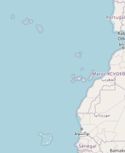

Tavoitteesta on nyt enää saavuttamatta Kanaria.

Ensimmäinen matkamme oli Kap Verdelle vuonna 2008. [Siitä matkasta on muutama blogikirjoitus](https://teuvovaisanen.fi/avainsanat/kap-verde/). Ostin silloin matkaa varten Lintuvarusteesta kirjan **Birds of the Atlantic Islands** ja päätin jo silloin, että onhan nuo lintukirjan neljä saariryhmää koettava, ennen kuin kasvatan horsmaa. Madeiralla vierailimme 2013. Ja nyt 2024 Azorit. Hitaasti tavoite etenee.

HELM FIELD GUIDES -sarjan lintukirja  
Birds of the Atlantic Islands  
ISBM 0-7136-6023-6

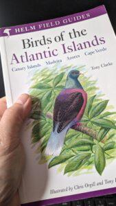

## Azorit

Azorit on yhdeksän saaren kokonaisuus Atlantilla, n. 1500 km Portugalista länteen. Se on hallinnollisesti itsenäinen osa Portugalia. [https://fi.wikipedia.org/wiki/Azorit](https://fi.wikipedia.org/wiki/Azorit)

Lensimme Air Francen ja Azores Airlinesin Airbuseilla Pariisin kautta São Miguel -saarelle Ponta Delgadan kaupunkiin.

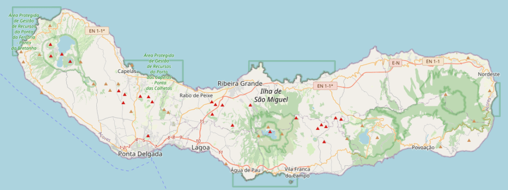

Saari on pienehkö, vain n. 60 km leveä ja kapeimmalta kohdaltaan vain 8 km korkea.

Majoituimme uskomattoman hienoon n. 100 vuotta vanhaan huvilarakennukseen, josta oli tehty pikkuinen kymmenisen huoneen hotelli. [Charming House - Casa Portuguese](https://www.charminghousesazores.com/en/casa/2/home) -hotelli oli nimensä veroinen, ihana aamiaishotelli. Kävelyetäisyydellä oli kaikki tarpeellinen Ponta Delgadassa. Lähistön ravintoloissa oli vaikea saada satasta rikki neljän hengen illallisella viineineen, mukava hintataso.

Parin päivän autovuokrauksen myötä tutustuimme saareen muutenkin kuin vain Ponta Delgadan pikkukaupunkiin. Viikko on lyhyt aika, monta mielenkiintoista kohdetta jäi kokematta. Saari on todella vihreä ja vehreä, paljon on maastoa ihmiset muokanneet maatalouden ehdoilla, lehmiä oli satamäärin pitkin saaren laitumia.

Saaren ainoa endeeminen lintu azorintulkku jäi näkemättä. Linnusto hieman yllätti, sillä niin paljon oli näkösällä ja äänessä suomalaisittain tuttuja lintuja. Tämä ei kyllä mikään erityinen linturetki ollut, vaan huvimatka. Lomailun lomassa havaitut:

- Sinisorsa

- Hiirihaukka

- Helmikana

- Liejukana

- Nokikana

- Karikukko

- Etelänharmaalokki

- Kalatiira

- Turkinkyyhky

- Kesykyyhky

- Sepelkyyhky

- Kauluskaija

- Virtavästäräkki

- Punarinta

- Mustarastas

- Mustapääkerttu

- Kottarainen

- Varpunen

- Vahanokka

- Kanarianhemppo

- Viherpeippo

- Tikli

- Peippo

Muutamia kuvia reissulta.

<figure>

<figure>

[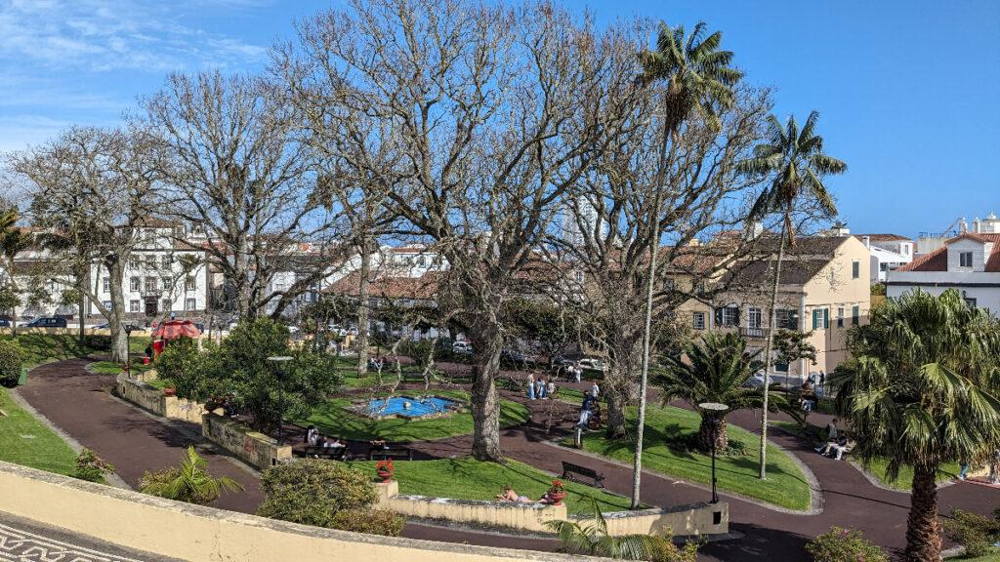](https://teuvovaisanen.fi/wp-content/uploads/2024/04/Puisto-hotellin-edessa.jpg)

<figcaption>

Puistonäkymä - Jardim Antero de Quental

</figcaption>

</figure>

<figure>

[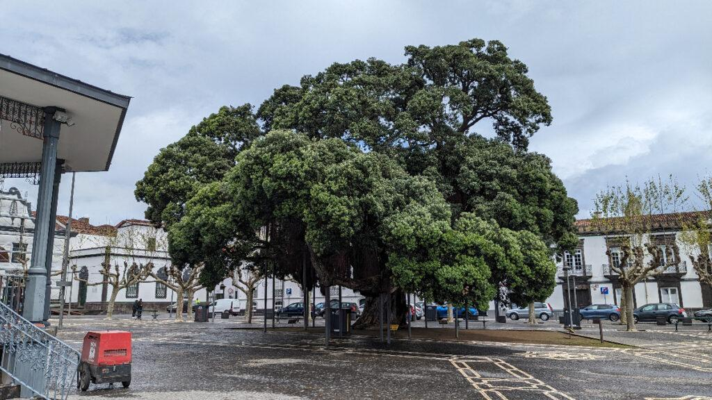](https://teuvovaisanen.fi/wp-content/uploads/2024/04/Iso-puu-aukiolla.jpg)

<figcaption>

Iso puu aukiolla - Ponta Delgada - Sao Miguel saarella

</figcaption>

</figure>

<figure>

[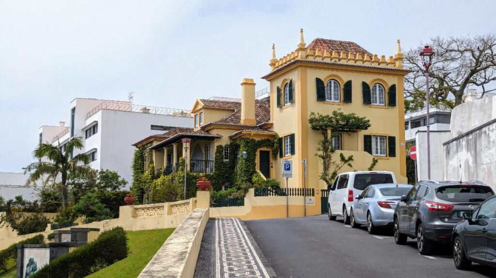](https://teuvovaisanen.fi/wp-content/uploads/2024/04/Casa-Portugueasa-Charming-House-hotelli.jpg)

<figcaption>

Hotelli - Charming House - Casa Portuguesa

</figcaption>

</figure>

<figure>

[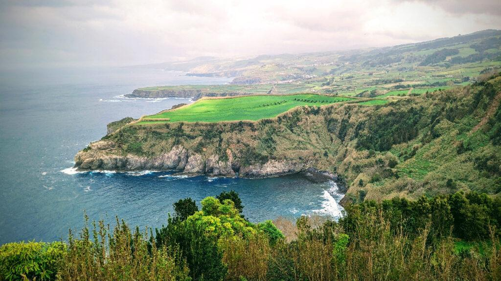](https://teuvovaisanen.fi/wp-content/uploads/2024/04/Nakyma-pohjoisrannalta-Sao-Miguel.jpg)

<figcaption>

Näkymä pohjoisrannalta Sao Miguel

</figcaption>

</figure>

<figure>

[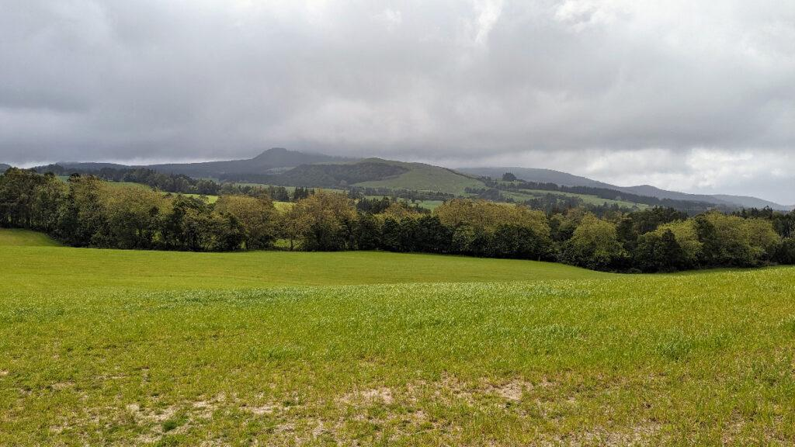](https://teuvovaisanen.fi/wp-content/uploads/2024/04/Vehrea-maisema-Sao-Miguel.jpg)

<figcaption>

Vehreä maisema Sao Miguel

</figcaption>

</figure>

<figure>

[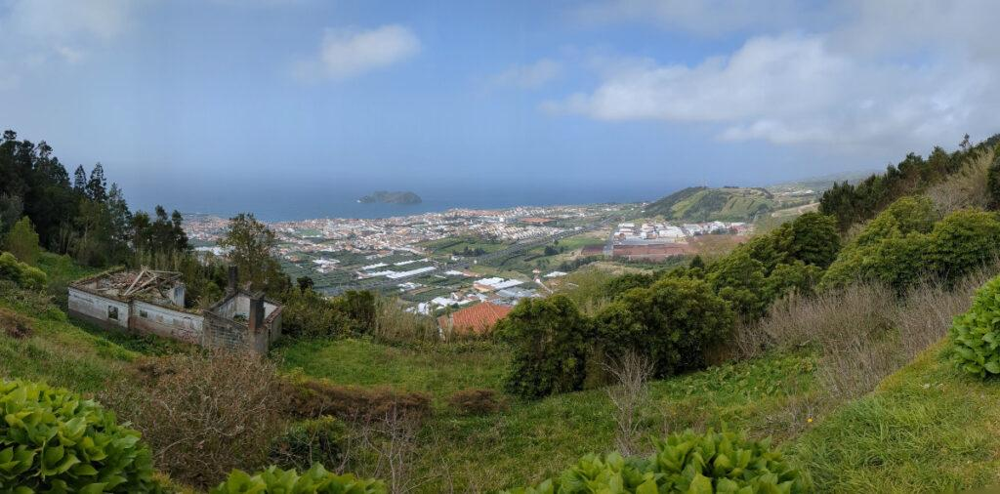](https://teuvovaisanen.fi/wp-content/uploads/2024/04/Panoraamakuva-etelarannalle-Sao-Miguel.jpg)

<figcaption>

Panoraamakuva etelärannalle Sao Miguel

</figcaption>

</figure>

<figure>

[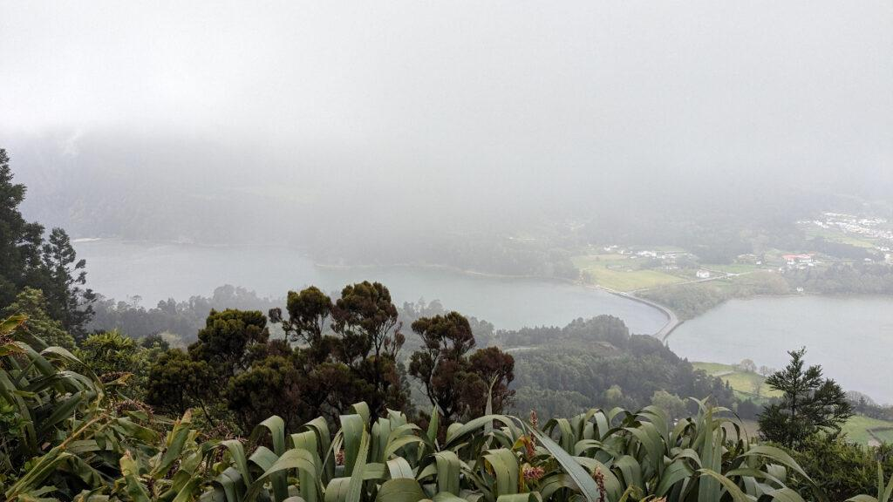](https://teuvovaisanen.fi/wp-content/uploads/2024/04/Sumuinen-nakyma-alas-kraaterijarville-Sao-Miguel.jpg)

<figcaption>

Sumuinen näkymä alas kraaterijärville Sao Miguel

</figcaption>

</figure>

<figure>

[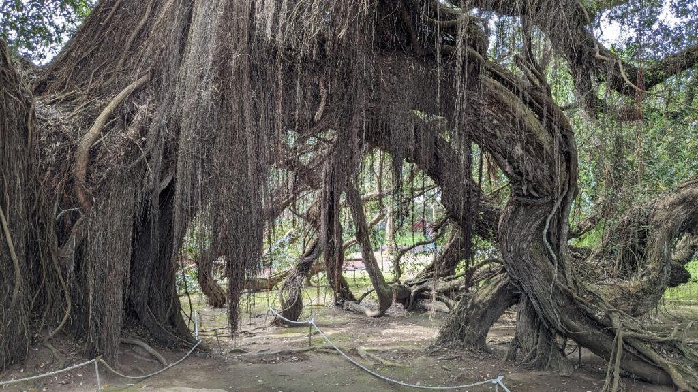](https://teuvovaisanen.fi/wp-content/uploads/2024/04/Kasvitieteellisessa-puutarhassa-Sao-Miguel.jpg)

<figcaption>

Kasvitieteellisessä puutarhassa Sao Miguel

</figcaption>

</figure>

</figure>
