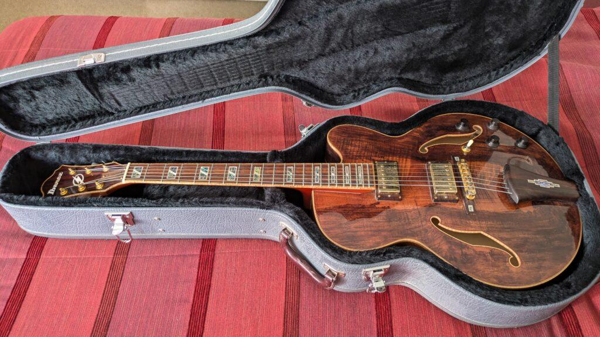
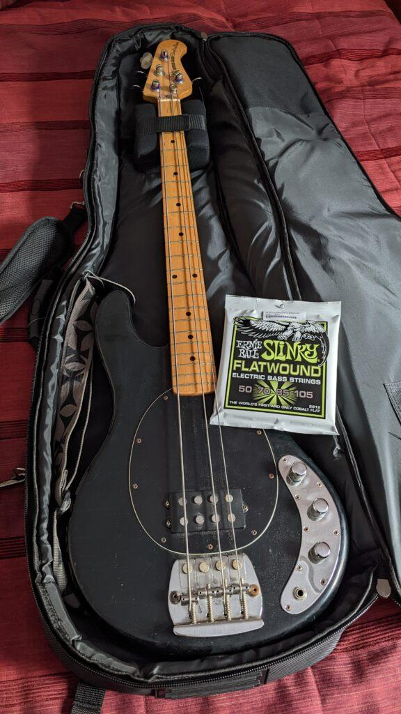

Olen viimeisen vuoden aikana vähentänyt kaikenlaisten romppeitteni määrää. Poistuneita ovat mm. auto, vene, tietotekniikkaa ja erilaisia musiikkilaitteita. Roskiin (lue sortti) on mennyt paljon myös kaikenlaista muuta turhaa. Miten sitä kertyykin kaikenlaista ja tulee säilytettyä, jos joskus vielä tartten -tyyliin? Auto ja vene olivat isoja menoeriä ylläpitoineen ja vakuutuksineen, niistä luopuminen näkyy eläkeläisen taloudessa selvästi :) Kulkuvälineet ovat nyttemmin julkinen liikenne ja etenkin sähköavusteinen polkupyörä. Niihin olen tyytyväinen. Auton voi vuokrata silloin , kun sitä oikeasti tarvitsee, tänä vuonna sen tehnyt kaksi kertaa.

Musiikkilaitteiden ja soittimien suhteen luopuminen on ollut paljon vaikeampaa kuin esimerkiksi auton ja veneen. Soittimiin muodostuu itselläni jotenkin aina sellainen suhde, jota on vaikea katkaista. Sitten kun jonkin soittimen/laitteen luopumisen lopulta hyväksyy, niin kas kummaa, sen tilalle ilmestyy jotain uutta soitinta ja laitetta.

Ibanez Artcore jazzkitara

Todella pitkällisen harkinnan jälkeen luovuin jazzkitarastani, se oli jäänyt aivan liian vähälle soitolle. Ibanez siirtyi mukavan tuntuiseen kotiin. Sekä myyjä että ostaja olivat tyytyväisiä. Päätin tiukasti, että en osta toista kitaraa tilalle. Se päätös on pitänyt.

Music Man StingRayBass - 1978

Vielä pidemmän harkinnan jälkeen luovuin ykkösbassostani, mustasta 1978 Music Man StingrayBass -soittimesta. Se oli vaikeaa. Minulla oli aikoinaan upea valkoinen Stingray, jonka ostin opintolainalla 1979 Helsingin Ruskeasuolta MS-Audiotron -liikkeestä. Luovuin siitä 90 -luvulla. kun bändihommat oli hiipuneet ja lapsiperhehommat olivat ajankohtaisempia. Kai ajattelin, että rokkibändibasistin hommat on ohi, sillä ostin tenorisaksofonin. Kaduin sitä jälkikäteen paljon. Kun myöhemmin sain tuttavalta ostettua mustan samanlaisen musarin, päätin etten koskaan siitä luovu. Se päätös ei pitänyt.  
Luovuin, sillä sain Stingraysta kunnon hinnan ja saan vaikka kaksi uutta bassoa tilalle ja rahaa jää vielä, jippii. StringRay meni henkilölle, joka oli omien sanojensa mukaan 30 vuotta odottanut tilaisuutta saada ostettua juuri tälläinen alkuperäinen Leo Fenderin suunnittelema Music Man. Onnea hänelle!

Nyt sitten odotellaan uutta soitinta :)

###### Fediverse -reaktiot
