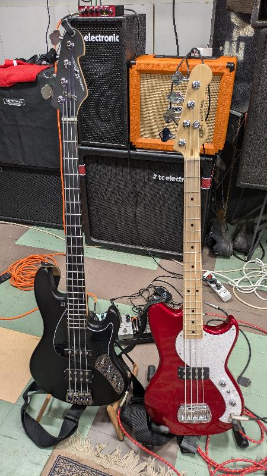

Tämä oli oikeasti suunnitelmissa. Kun sain vuosimallia 1978 Stringray basson myytyä hyvään hintaan, oli aika hankkia uusi ykkösbasso tilalle. Niin ja hupsista, kakkosbasso myös.

## Ykkösbasso - Sandberg 70th Anniversary Electra TM EF MH SB

Minulla oli aikoinaan kaunis ja erinomaisesti soiva pitkäkaulainen 35" [Sandberg California TM5 -basso](https://teuvovaisanen.fi/2020/07/24/myydaan-5-kielinen-basso-sandberg-california-tm5/), josta luovuin pitkälti ergonomian vuoksi. Nyt kun etsiskelin itselleni uutta ykkössoitinta, satuin huomaamaan saksalaisen Thomann -verkkokaupan sivuilla ko. kaupan 70 -vuotistarjoukset. Tarjouksien joukosta löytyi myös muutama Sandberg, nyt myös nelikielisenä 34" eli normaalipituisella kaulalla ja samalla mikrofoniyhdistelmällä kuin entinen viisikieliseni. Tilasin oitis. Olisin mieluusti ostanut basson Suomesta, mutta tämä oli erikoisversio ja saatavilla vain T-kaupasta. Verkosta soittimen ostaminen on aina riskaabelia, se ei ehkä olekaan sitä mitä toivoi, se ei miellytä tai siinä on jotain vikaa. Onneksi T-kaupan ehdoissa on jopa 30 vrk palautusoikeus, joten riski on siten selvästi pienempi. Parisen viikon odotuksella basso tuli DHL -kuljetuksella ja pääsin vihdoin kokeilemaan.

### Soittimen säätö soittokuntoon

Muutama koesoitto ensin tehdasasetuksilla ja kielillä. Harvoin on kielisoitin kaupasta tullessaan laitettu oikeasti soittokuntoon. Soitin kannattaa viedä ammattilaiselle, jos ei itse osaa säätää soitinta soittokuntoon. Helsingissä on erinomainen liike avuksi, [Kitarapaja](https://www.kitarapaja.com/). Itseltäni onnistuu kyllä perussäädöt ja arvioin, että tämän soittimen "setup'in" osaan tehdä itse, siispä toimeen.

Ensin uudet kielet. Minulla oli Musarissani sileät, mutta kirkkaasti soivat kielet ja laitoin tähän samanlaisen setin eli [Ernie Ball Slinky Cobalt Flatwound](https://www.ernieball.com/guitar-strings/bass-strings/slinky-cobalt-flatwound-electric-bass-strings/slinky-cobalt-flatwound-4-5-electric-bass-strings#P02812), 50-70-85-105. 
Kaula oli sopivan suora, sitä ei tarvinnut säätää. Kielien korkeus oli säädettävä, ne olivat omaan soittotyyliini aivan liian matalalla, teräksiset tehdaskielet kilisivät nauhoihin. Mikrofonit olivat aivan liian korkealla, liian lähellä kieliä. Onneksi säätöruuvit riittivät madaltamiseen.  
Intonaatio vielä lopuksi, näin soitin on vireessä myös korkealta asteikon yläpäässä.  
Näillä säädöillä bassosta tuli itselleni helposti soitettava ja toimiva kokonaisuus.

Säätöjen jälkeen koesoittoa kotona Two Notes Bass ReVoltilla ja parilla eri soittokämpällä eri vahvistimilla. Olin tyytyväinen, soitinta ei tarvitse palauttaa liikeeseen, vaan voi tehdä arvostelun verkkokaupassa onnistuneen kaupan johdosta. Ei tämä mikään unelman täydellinen soitin ole, mutta itselleni aivan riittävän laadukas, olenhan vain harrastaja.

## Kakkosbasso - G&L Tribute Series Fallout Bass

Leo Fender on ylivoimaisesti eniten sähköbasson kehittymiseen vaikuttanut henkilö.  
Lue lisää Leo Fenderistä [https://en.wikipedia.org/wiki/Leo\_Fender](https://en.wikipedia.org/wiki/Leo_Fender)  
Hän perusti eläessään kolme merkittävää soitinrakennusliikettä:

- [Fender](https://www.fender.com/)

- Music Man nykyään [Ernie Ball](https://www.ernieball.com/)

- [G&L](https://www.glguitars.com/)

Itselläni on/ollut parit Fenderit ja parit "musarit", mutta ei koskaan vielä G&L:ää. Siispä nyt oli sellainen saatava. Haasteena hankinnalle oli se, ettei maahantuontia ole pohjoismaissa enää, eikä iso T-kauppakaan sitä enää pidä tarjonnassaan. Olin pitkään katsellut videoita lyhytkaulaisesta 30" Fallout bassosta juutuupissa. Käsin amerikassa tehtyyn ei ollut varaa, joten Tribute Series -sarjan soittimeen oli tyytyminen. Löysin lopulta Slovakialaisesta verkkokaupasta haluamani.

Aika samat temput joutui tekemään tällekin soittimelle, kielien ja mikrofonin korkeussäädöt sekä intonaatio. Tässä piti kaularautaa pikkaisen käännellä, jotta sai kaulaan sopivan muodon.  
Koesoittoja eri ympäristöissä. Tämä soitin jää käyttöön rokkibassoksi jamikämpille. Kirjoitin vielä verkkokauppaan arvostelutekstin onnistuneen kaupan johdosta.

Loppujen lopuksi hyvinhän näissä ostoksissa kävi, ei tarvinnut kumpaakaan palauttaa. Ja rahaa jäi vielä jäljellekin musarikaupoista.
