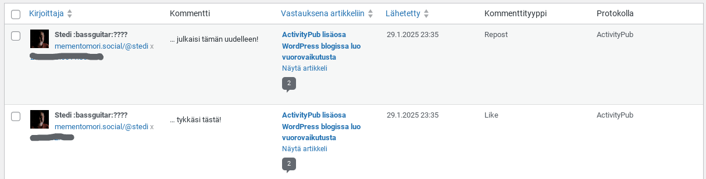

Ennen kirjoittelin blogiin "oikeita juttuja", WordPressistä ja sekalaisista nörttijutuista. Olinhan IT-ihminen, kun olin vielä töissä. Nyt ollessani eläköitynyt vaari-ihminen, kirjoittelen harvemmin ja pitkälti vain oman elämän hömpsötyksistä. Sen myötä interaktiot blogikirjoituksiin ovat selvästi vähentyneet. Ei niitä enää jaeta saati sitten että keräisivät kommentointeja. Ei se ole minua haitannut, elämä on muuttunut, rauhallisemmaksi.

Nyt kuitenkin "jostain kumman syystä" blogiin on ilmestynyt kommentteja, oikeilta ihmisiltä eikä spämmiroboteilta. No se kumma syy on tietty se, että kytkin WordPress -sivustoni Fediversumiin. Asensin ActivityPub -lisäosan ja simsalabim, sivustostani tuli osa fediä. Aina kun julkaisen artikkelin, putkahtaa se saman tien fediversumiin. Seuraan fedissä omaa blogiprofiiliani ja usein myös sitten itse boostaan sitä julkaistua artikkelia. Jos ja kun ihmiset tykkäävät tai vastaavat kirjoitukseen, ilmestyvät ne blogikirjoitukseen kommenteiksi. Tämähän on tosi kiva ja lämmittää minua suuresti. Vaikka nykyään ikäänkuin kirjoittelen itselleni, niin on kuitenkin mukava, kun huomaa, että joku on sen lukenut ja reagoi siihen. Ihan niin kuin ennen vanhaan blogosfäärissä. Näen myös WordPressin hallintasivuilta kätevästi kaikki kommentit sekä blogini seuraajat ja artikkelin lopussa tykkäykset avatarien kera.

No, ei minulla mitään sen kummempaa markkinointitarvetta omille jutuilleni ole, mutta ajattelen heitä monia, jotka tänne fediin ovat tulleet nyt pakoon X:stä ja Metan palveluista. Moni on vielä työelämässä ja kirjoittavat blogia ja se saattaa olla heille tärkeä bisneksen apuväline. Heille näkisin tuon ActivityPub -lisäosan tuoman näkyvyyshyödyn olevan potentiaalinen.

Tuon ActivityPub -lisäosan asentaminen ja konfigurointi omaan WordPress -sivustoon on helppoa, suosittelen sitä lämpimästi.  
Lisäosa löytyy täältä:  
[https://fi.wordpress.org/plugins/activitypub/](https://fi.wordpress.org/plugins/activitypub/) ja sen saa siis myös suomenkielisenä, sattuneesta syystä, sillä olen ko. lisäosan suomentaja. Tuolla lisäosan selitesivuilla on muuten ihan ok selitys Youtube -videolla Fediversumista, vähän ameriikan tyyliin, mutta ihan asiaa.

EDIT:  
Julkaisun jälkeen boostasin blogikirjoitusta ja tykkäsinkin. Näin se näkyy WordPress hallintapaneelissa:

Ja tykkäykset näkyvät tässä artikkelin alapuolella. Otsikko Likes on englanniksi, vaikka kaikki lisäosan stringit on 100% käännetty. Tuota sanaa ei ko. lisäosan hallinnoija ole ehkä muistanut tuoda kääntämisen piiriin.

