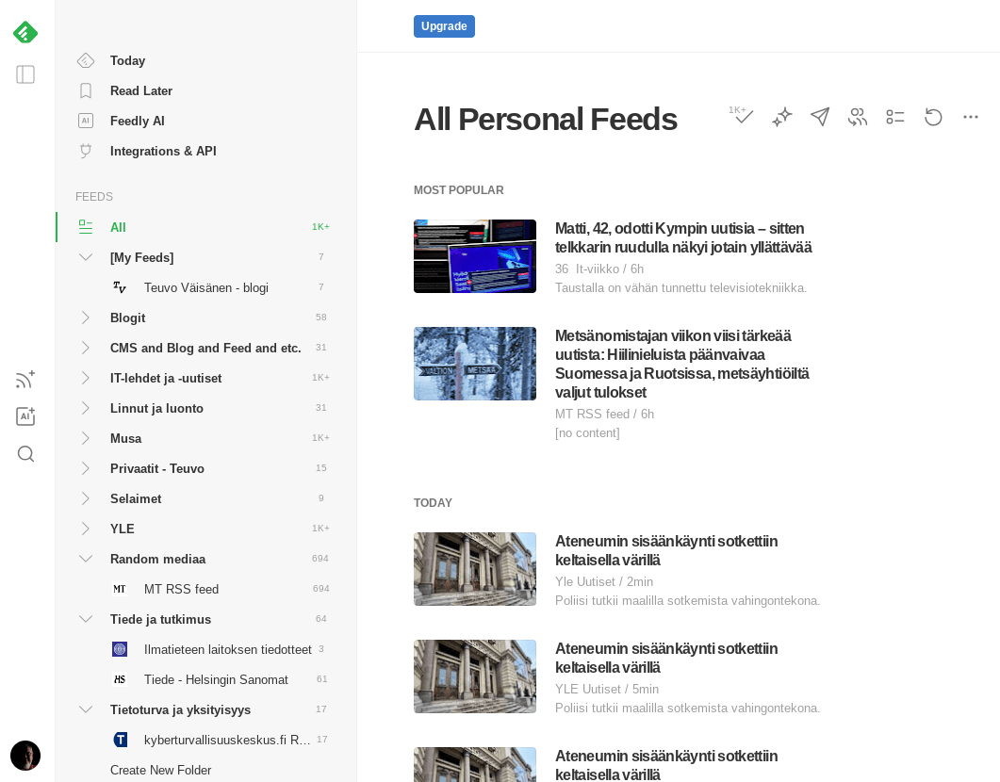

Viilailin pitkästä aikaa snadisti webbisivustoani ja sen alapalkkia. Siellä minulla on linkki RSS-syötteeseen, jonka avulla voi seurata etänä milloin uusia artikkeleita ilmestyy tällä sivustolla.  
RSS -syöte muodostuu automaattisesti WordPress -järjestelmässä ja se on ollut vuosien saatossa etenkin blogimaailmassa merkittävä tapa tiedon jakamiseen ja verkostoitumiseen, blogosfääri!

> RSS (RDF Site Summary tai Really Simple Syndication) on verkkosyöte, jonka avulla käyttäjät ja sovellukset voivat käyttää verkkosivustojen päivityksiä standardoidussa, tietokoneella luettavassa muodossa. RSS on XML:ää.

[Lue lisää englanninkielisestä Wikipedian RSS -artikkelista](https://en.wikipedia.org/wiki/RSS), suomenkielinen artikkeli on melko tynkä.

RSS:n suosio on hiipunut, sillä isot toimijat ovat ainakin yrittäneet lopettaa sen tuen, onneksi siinä kuitenkaan onnistumatta. Ei se RSS mihinkään todellakaan ole kuollut, pikemminkin pikkuhiljaa noussut uudelleen käytettyjen tekniikoiden piiriin, etenkin kun Fediversumi on nosteessa.

## RSS työkäytössä

RSS oli minulle henkilökohtaisesti merkittävässä roolissa kun olin vielä töissä. Seurasin aktiivisesti maailman webbiguruja ja heidän blogejaan, joissa he kirjoittivat uusista tekniikoista ja niiden kehittymisestä. Gurujen blogit olivat minulle mainioita oppimispaikkoja omien taitojeni kohentamisessa ja siinä, että kouluttajana pysyin kärryillä uusimmista jutuista. Blogeja oli todella paljon ja ne olivat tietty kaikki eri osoitteissa, niiden kahlaaminen yksitellen olisi vienyt tuhottomasti aikaa. Onneksi kaikki sivustot tarjosivat RSS-syötteen. Seuraamieni sivustojen RSS -syötteet sain koottua yhteen nippuun RSS -lukijaohjelmaan, josta ne pystyi otsikkotasolla kätevästi lukemaan samaan tapaan kuten sähköpostiohjelmissa sähköpostit. Kun näki mielenkiintoisen otsikon ja ingressitekstin, pystyin napsautuksella siirtymään selaimella ko. sivustolle artikkelia lukemaan. Aamurutiineihini kuului toimistopäivinä RSS -syötteiden ja sähköpostien läpikäynti. Käytin RSS:n lukemiseen paljon FeedDemon -ohjelmaa ja myöhemmin myös GoogleReader -ohjelmaa. Molemmat on lopetettu. No minullakin RSS:n käyttö hiipui, kun en enää ole töissä ollut vuosiin, mutta itse tekniikka on ja pysyy ja uusia ohjelmia on niiden lopetettujen tilalla.

## RSS tänään

Verkossa on nytkin paljon RSS -syötteitä, eivät ne mihinkään ole kadonneet julkaisujärjestelmistä eikä blogiohjelmista. Nykyään näkee harvemmin enää RSS -kuvaketta, josta oivaltaisi, että syöte on tarjolla. Vaikka kuvake usein puuttuukin, niin kyllä se syöte siellä sivustolla silti on. Aina voi kokeilla löytyykö syötettä tarjolla yleisimmistä RSS:n osoitteista kuten:

```
https://sivuston-nimi.fi/rss 
https://sivuston-nimi.fi/feed 

Joskus syöte on myös tarjolla Googlen FeedBurner -palvelun kautta kuten minulla:
https://feeds.feedburner.com/stedi 
Siinä on omat etunsa, sillä jos vaihtaa domainia tms. säilyy syötteen osoite ennallaan.
```

Kaiken lisäksi suuri osa mediataloista jakaa uutisensa RSS -syötteenä. Niitä onkin näppärä seurata RSS:n avulla, niin ei tarvitse katsella sivuston mainoksia ;)

Esimerkiksi YLE:n RSS -syötteet löytyvät täältä [https://yle.fi/uutiset/rss](https://yle.fi/uutiset/rss)

## RSS lukijaohjelmat

Vaikka FeedDemon ja Google Reader aikoinaan lopetettiinkin, niin on muitakin ohjelmia olemassa RSS:n lukemiseen.

Itse käytän nykyään Feedlyä, [https://feedly.com](https://feedly.com) . Se on verkkopalvelu jolla voi lukea RSS -syötteitä selaimessa. Palvelusta on maksuton sekä paranneltu maksullinen versio.

 

Lisää lukijaohjelmia löytyy kun tekee hakukoneeseen haun fraasilla "RSS readers"

## Sähköpostiohjelma RSS -lukijana

Monelle voi tulla yllätyksenä, että perinteisiä sähköpostiohjelmia voi käyttää RSS:n lukemiseen. Siinä on ainakin se etu, että voi samalla ohjelmalla lukea sähköpostit otsikot ja RSS:n otsikot.

Microsoftin Outlook tukee RSS -tekniikkaa  
[https://support.microsoft.com/en-us/office/subscribe-to-an-rss-feed-73c6e717-7815-4594-98e5-81fa369e951c](https://support.microsoft.com/en-us/office/subscribe-to-an-rss-feed-73c6e717-7815-4594-98e5-81fa369e951c)

Mozillan Thunderbird tukee RSS -tekniikkaa  
[https://blog.thunderbird.net/2022/05/thunderbird-rss-feeds-guide-favorite-content-to-the-inbox/](https://blog.thunderbird.net/2022/05/thunderbird-rss-feeds-guide-favorite-content-to-the-inbox/)

Googlen GMail omalla tavallaan tukee tekniikkaa ainakin tämän artikkelin osion mukaan. Siinä on ohjeet noille muillekin.  
[https://solinkit.com/how-to-add-an-rss-feed-to-outlook/](https://solinkit.com/how-to-add-an-rss-feed-to-outlook/)  
(Itse en saanut sitä GMailissa toimimaan.)

## RSS ja Fediversumi

Omalla tavallaan Fediversumin suosion nousu on nostanut myös RSS:n suosiota tai ainakin näkyvyyttä. Moni fedin käyttäjä on tuskastunut siihen, että mediatalot ym. suositut tahot eivät ole liittyneet fediin, vaan möllöttävät noissa kaupallisissa someissa.

Onneksi mediatalojen sisältöjä saa tuotua fediversumiin esim. [RSS Parrot](https://rss-parrot.net/) -tyyppisten palvelujen avulla. RSS Parrotille voi syöttää haluamansa RSS-syötteen osoitteen ja sen jälkeen alkaa fediin ilmestymään tootteja sitä mukaa kun RSS-syötteeseen tulee uutta sisältöä syötteeseen. Olen itse syöttänyt mm. Ylen tuoreimmat uutiset RSS:n ja siitä on sitten tullut Mastodon osoite [https://rss-parrot.net/u/yle.fi.uutiset](https://rss-parrot.net/u/yle.fi.uutiset)  
Näin jokainen voi tuoda suosikkipalvelunsa fediin ikäänkuin takaoven kautta ;)

Itse fedikin tarjoaa palveluistaan RSS -syötteen, ainakin Mastodon. Minun Mastodon -tilini osoite selaimessa on [https://mementomori.social/@stedi](https://mementomori.social/@stedi) ja jos haluaa seurata toottejani RSS:llä ilman että on tiliä Mastodoniin, niin toottien RSS:n saa, kun lisää osoitteen perään .rss , siis [https://mementomori.social/@stedi.rss](https://mementomori.social/@stedi.rss) , ja siitä sitten seurantaan RSS -lukijaan.

## Loppusanat

RSS on vanha mutta elossa oleva tekniikka, itse pidän sitä edelleen todella relevanttina tekniikkana, josta on paljon hyötyä. Suosittelen tutustumaan jos aihe on vieras ennestään.  
Jos kiinnostuit, niin lue lopuksi vielä vaikkapa Cory Doctorowin artikkeli Mediumista [You should be using an RSS reader](https://doctorow.medium.com/you-should-be-using-an-rss-reader-76aed31151f9)

###### Fediverse -reaktiot
