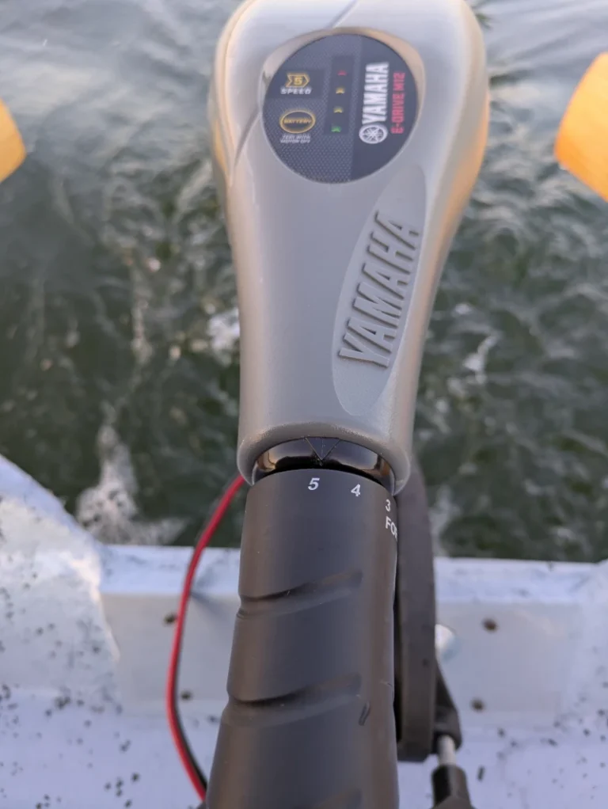
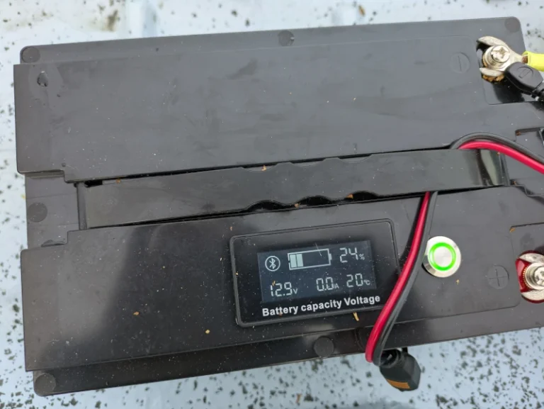
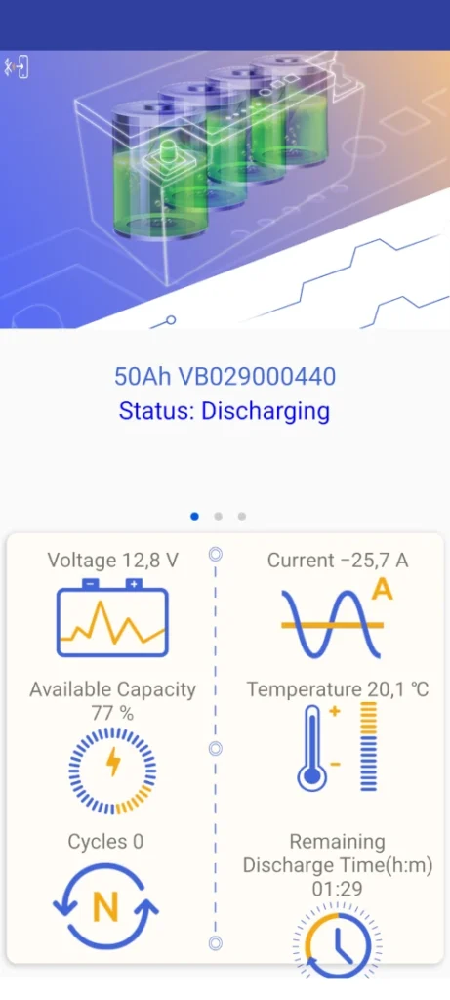
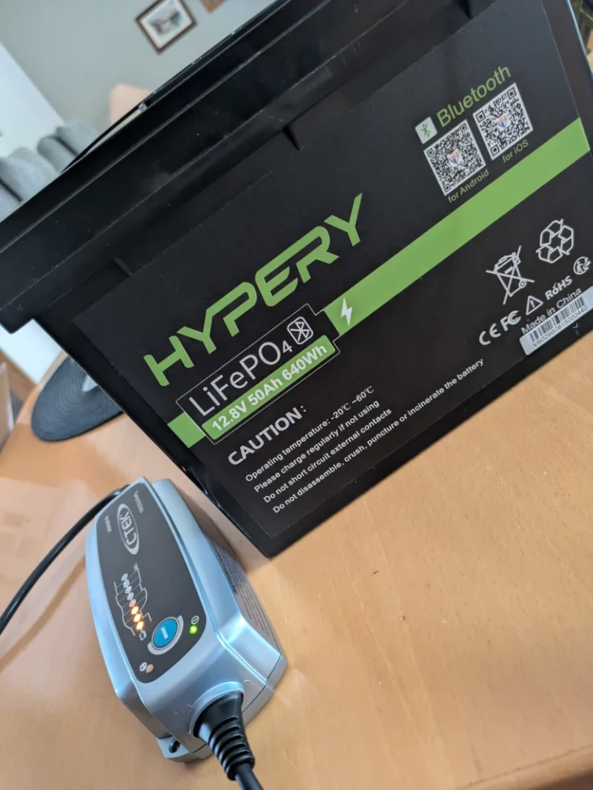
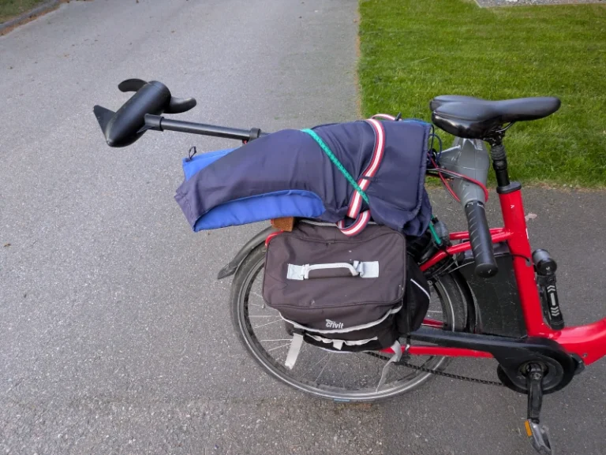
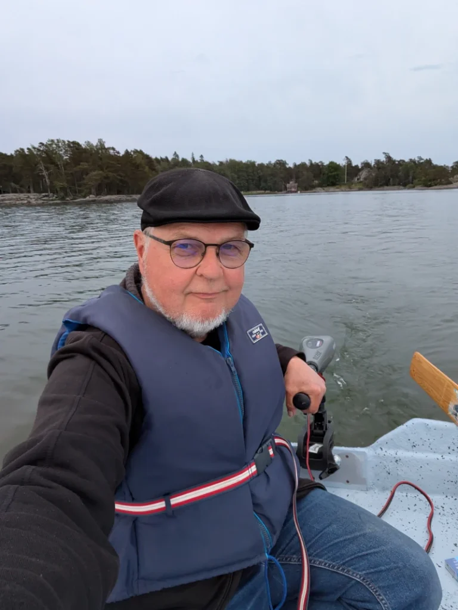

Pitkäaikainen haaveeni soutuveneestä on siis totta. Soutaminen on kivaa. Mutta pitäähän se moottorikin olla ;)

Hankin tuttavaltani käytetyn sähköperämoottorin, Yamaha E-Drive M12. Tämä on kaiketi niitä pienimpiä markkinoilla olevia, työntövoima 13,6 kg. Ensikokeilu tuli tehtyä pienellä lyijyakulla, arviolta reilua soutuvauhtia tuo etenee nopeimmillaan. Viisi vaihdetta eteen ja kolme taakse.

 

Lyijyakkua en kuitenkaan halua, se mm. painaa liikaa. Lyijyakku ei myöskään pysty tarjoamaan kaikkea virtaa ulos, vaan ehkä vain noin puolet akun kapasiteetista. Siksi päätin hankkia Litium-akun. Litium-akku painaa n. kolmasosan lyijyakusta ja se kykenee tarjoamaan käyttöön jopa 95% akun kapasiteetista. Myös elinikä on moninkertainen lyijyakkuun verrattuna, jopa 3000-5000 latauskertaa verrattuna lyijyakun muutamaan sataan latauskertaan.

 

HYPERY Smart 12V 50AH Bluetooth. Akku on varustettu omalla näytöllä, josta näkee nopsaan akun tilan. Sen lisäksi, kuten mallinimi kertoo, on siinä myös bluetooth ja kännykän sovelluksella voi seurata akun varauksen ja kulutuksen tilannetta reaaliajassa.

 

Laturi oli myös hankittava, sillä lyijyakkujen laturilla ei litium-akkua saa ladata. Hankin CTEK Lithium XS -automaattilaturin.

 

Akku mahtuu polkupyörän sivulaukkuun ja itse moottorin saa kätevästi kulkemaan polkupyörän tavaratelineellä venerantaa ja sieltä pois. Ei uskalla jättää veneeseen, vaikka onkin kerhon lukitun portin takana.

 

Koeajolla kerkisin käymään uuden akun kanssa ja parin tunnin verran tuo tarjoaa apua matkantekoon, jos ajaa täysillä.

Ergonomia pienessä soutuveneessä on kehno, jos joutuu kököttämään peräpenkillä. Täytyy virittää jatkovarsi moottorin ohjaus/kaasukahvalle, jotta voi istua paremmin keskipenkillä. Siinä saa jalat paremmin suoraksi ja varmaan venekin kulkee tasapainoisemmin, kun paino on paremmin keskellä.

 

Hiljaista menoa. Ehkä uistelen tuon kanssa.

