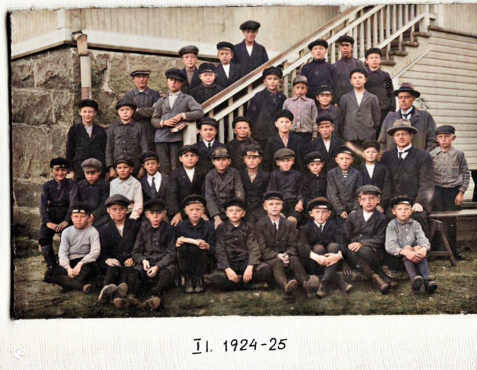

On se varmaan niin, että kun ikää tulee itselle, niin tulee jonkinlainen tarve ja kiinnostus ottaa selville menneitä asioita. Sukututkimus on kuulemma harrastus, johon voi hurahtaa pahemman kerran. Olen parin vuoden verran aina silloin tällöin keskittynyt asiaan, isompaa hurahdusta ei ole kuitenkaan tapahtunut.

Silloin kun on nuorempi, ja vanhemmat ovat vielä elossa, ei tule kyseltyä asioita. Jälkikäteen harmittaa, kun ei enää voi kysyä. Lähisuvussani on muutamia henkilöitä, jotka ovat teettäneet DNA-testin ja sen avulla jäljittäneet sukulaisia. Mitään mullistavaa ei ole löytynyt. Itse en aio millekään taholle tuota DNAtani antaa. Kun aloitin tutkimuksen, tein tunnukset [https://www.geni.com](https://www.geni.com) -palveluun. Sain yllättävän helposti rakennettua sukupuun sekä isän, että äidin puolelta. Isän puolelta pääsin jonnekin 1700 -luvulle isiä seuraamalla, mielenkiintoista. Lopulta minua alkoi harmittaa, kun tuo palvelu on israelilainen, lopetin maksamasta vuosimaksua. Noh, nätti sukupuu on tallessa.

Jatkossa alkoi enempi kiinnostaa omien vanhempieni historia. Olivathan isä ja äiti jutelleet kaikenlaista menneisyydestä eli ajasta ennen syntymääni, mutta mustia aukkoja oli minulla tiedoissa paljon. Kutsuin isosiskoni ja isoveljeni muistelupäivään, he tiesivät vanhoja asioita paremmin kun olivat minua 7 ja 9 vuotta vanhempia. Se olikin antoisa päivä. Minulla oli äänityslaite, joka tallensi jutusteluamme. Katseltiin vanhoja kuvia ja tarinoitiin. Meidän kolmen muistot täydensivät mainiosti toisiaan.

Aloitin tarkemmin tutkia isäni lapsuutta ja nuoruutta, joka oli melkoisen hämärän peitossa. Ei ollut lainkaan valokuvia hänen lapsuudestaan, vanhimmat kuvat olivat varusmiespalveluksen ajalta. Kouluasioista ei ollut muuta tietoa kuin se, että isä oli puhunut Lahden lyseosta. [https://fi.wikipedia.org/wiki/Lahden\_lyseo](https://fi.wikipedia.org/wiki/Lahden_lyseo)

Laitoin sähköpostia nykyiselle Lahden lyseon rehtorille ja kysyin löytyykö vanhoja tietoja oppilaista.  
Onnenpotku! Lahden lyseosta olivat nykyinen rehtori ja koulun entinen oppilas tehneet ison työn dokumentoiden lyseon 100-vuotista historiaa, vuosilta 1921 – 2021 ja siitä oli tehty julkaisu.  
[https://poikakoulustaponnistaen.fi](https://poikakoulustaponnistaen.fi)  
Tuosta julkaisun taustatyöstä hyödyin valtavasti, sillä sain haltuuni isän kouluvuosilta koulun vuosikertomukset digitoituina ja ennen kaikkea luokkakuvan ensimmäiseltä luokalta. Se oli nähtävästi deoldify-palvelun tms. avulla vielä muunnettu värikuvaksi. Löysin poikajoukosta heti n. 11-vuotiaan isäni. Olipa mahtava tunne katsella kuvasta nuorta faijaani (isä oli meillä faija ja äiti oli mutsi).

Isäni Kalervo toisessa rivissä opettajasta vasempaan toinen poika, raidallinen pusero takin alla.

Ennen lyseon aikaa oli isäni asunut jonkin aikaa Kuopiossa, jossa äidillään oli ompelimo Tulliportinkadulla aivan Kuopion keskustassa. Hän on siis koulun alkutaipaleen käynyt varmaankin Kuopiossa. Laitoin taas kokeeksi sähköpostia erään kuopiolaisen peruskoulun rehtorille ja kyselin vanhoja oppilastietoja. Niitä ei säilytetä koulussa ja hän ohjasi Kuopion kouluviraston puoleen. Sinne siis taas sähköpostikysely. Jokin aika sitten kouluvirastosta soitti ystävällinen naishenkilö, jonka kanssa sovittiin, että hän tilaa Joensuusta Kansallisarkistosta kouludokumentit, joita voisin sitten tulla Kuopioon tutkimaan.  
Tästä uutta yhteydenottoa nyt odottelen ja kohta matka suuntautuu syksyiseen Kuopioon.

