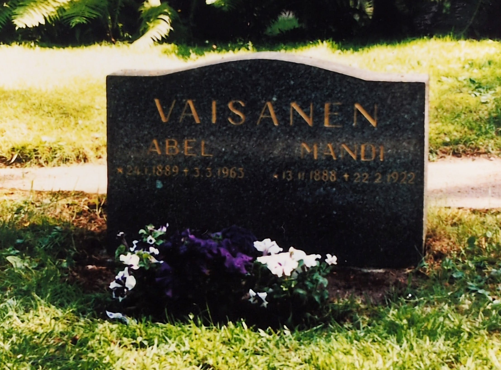
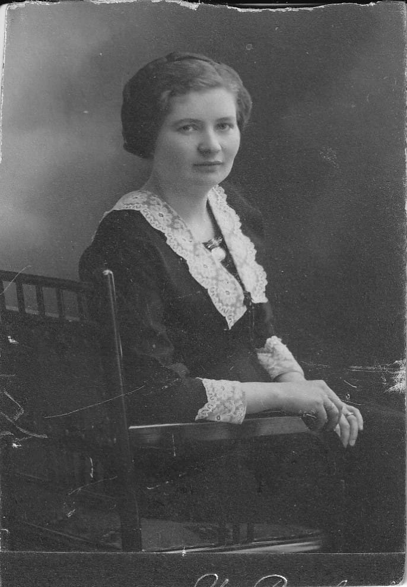
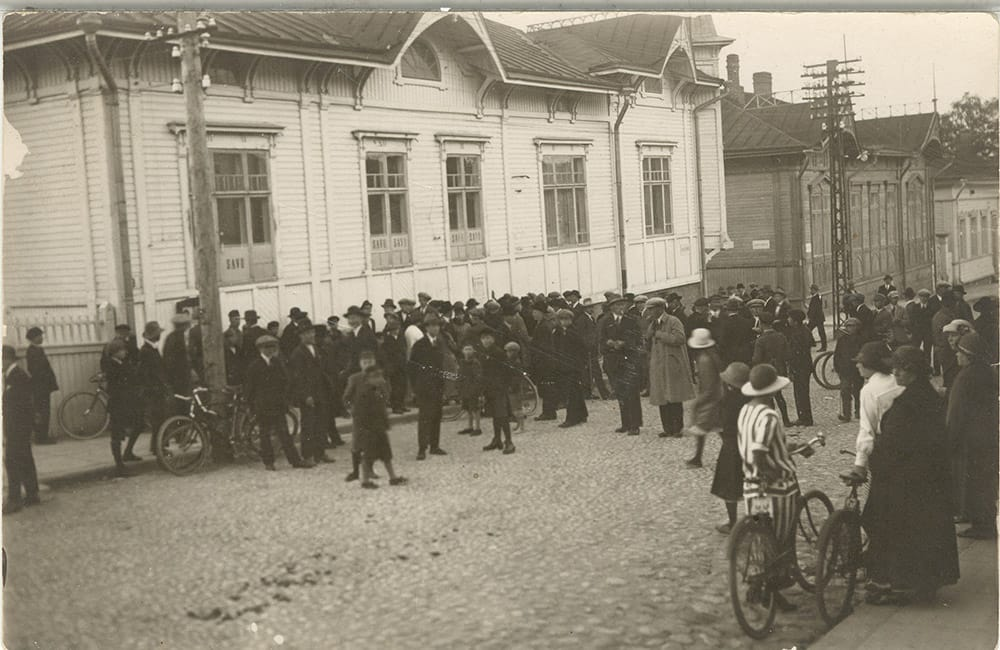

Kuopion kaupunki soitti melko pian yhteydenoton jälkeen, että nyt Kuopion kansakoulujen paperiniput Joensuun Kansallisarkistosta odottivat tutkijaa Valtuustotalolla arkistossa. Ei muuta kuin junaliput ja parin yön majoitusvaraus Veturi B&B:hen, pieneen hotelliin entisessä rautatieasemarakennuksessa. Rakennuksessa myös aamiaiskahvilana toimiva Lentävä Kalakukko. Vaatimaton, mutta hinta-laatusuhteeltaan mainio, hyvä sänky, asiallinen aamupala.

Syyskuun lopulla matkamme tulopäivänä ohjelmassa ensin käyskentelyä Kuopin hautausmaalla, siinä aseman veressä. Etsiskeltiin faijan vanhempien hautaa, oltiin käyty siellä viimeksi kesällä 1986 lomamatkallamme Riistavedelle. Eipä löytynyt, hautojen merkinnät olivat puutarhatyöntekijän mukaan muuttuneet eikä muistikuvat sijainnista enää kertoneet missä tarkalleen hauta oli sijainnut. Hautausmaan toimistokin oli juuri mennyt kiinni. Laitoin sitten illalla kyselysähköpostia hautausmaalle. Seuraavana päivänä tulikin heti vastaus, että hauta on otettu seurakunnan käyttöön 2000-luvun alkupuolella, kun hauta ei enää ollut kenenkään hoidossa. Arvasin näin käyneen. No muistokuva haudasta on.

 

Kuva hautakivestä on Väisästen perhealbumista

## Kansakoulutietojen tutkinta

Seuraavana aamuna Valtuustotalolle. Siellä odottikin muutama iso nippu 1920-luvun kansakoulupapereita. Ja tieto, että osaa papereista ei minulle anneta, sillä niissä on uuden henkilötietolain alaisia tietoja, jotka on suojattu. Samoin tieto, että valokuvata ei saanut, iso pettymys :(

Tutkittavaa kuitenkin riitti ja olihan minulla muistivihko ja lyijykynä.  
Oli mm. isokokoinen paksuhko kirja, jossa listattuna kouluun kirjautuneet oppilaat vuosittain, siis **oppilasmatrikkeli**. Matrikkelista selvisikin helposti se tieto, että Kalervo oli käynyt neljä kansakoululuokkaa täällä Kuopiossa, vuosiluvut 1920, 21, 22 ja 23 oli matrikkeliin merkitty. Siis normaalit neljä kansakoululuokkaa.

Toinen pienempi kirja oli "**Poikain käsityöarvostelut**". Sieltä löytyi mm. viimeisen lukuvuoden syksyltä kaksi työtä. Faija oli tehnyt laatikon, siitä arvosana 8 ja viivoittimen, josta arvosana 6. Viimeisen luokan kevään kohdalla luki "eronnut". Erosiko isä kesken neljättä luokkaa 1923-24 vai erosiko vain käsitöistä? Kenties muutti synnyinkaupunkiin Lahteen, jossa aloittikin lyseon syksyllä1924.

Sitten paksujen paperinippujen kimppuun. Päällimmäisenä olikin ensimmäisen luokan nimilista kauniilla kaunokirjoituksella ja allekirjoituksena Elvira Streng. Ensimmäisellä luokalla oli 17 tyttöä ja 18 poikaa, yhteensä 35 oppilasta. Toisella luokalla 21 tyttöä ja 16 poikaa, yhteensä 37 oppilasta. Isoja luokkia olivat olleet. Opettajana oli ainakin kaksi ensimmäistä luokkaa tuo Elvira Streng, oliko hän ankarakin kenties? ;)  
  
Paperipinot kävin läpi yksitellen hapero paperi kerrallaan. 1920-24 väliseltä ajalta löysin muutamat isäni kouluarvostelut, jotka kirjasin muistivihkooni.

| Aine | 1\. luokan kevät 1921 | 2\. luokan kevät 1922 |
| --- | --- | --- |
| Käytös | 10 | 10 |
| Ahkeruus ja tarkkuus | 8 | 8 |
| Uskonto | 7 | 8 |
| Sisäluku | 7 | 8 |
| Kaunokirjoitus | 7 | 7 |
| Oikeinkirjoitus |  | 8 |
| Luvunlasku | 8 | 7 |
| Laulu | 8 | 8 |
| Piirustus | 5 | 5 |
| Käsityöt | 9 | 8 |
| Keskiarvo | 7,2 | 7,3 |

Melko nopsaan sain käytyä papereita läpi ja oikeastaan olin saanut melkein kaiken tiedon, jota halusinkin, olin tyytyväinen ja kiitin arkistopaperit Joensuusta minulle tilannutta ystävällistä naisvirkailijaa. Erinomaista palvelua sain Kuopion kaupungilta.

Ainoastaan luokkakuvia ei ollut, eikä kotiosoitetta löytynyt koulun papereista. Se kotiosoite oli keksittävä muulla keinoin. Niin ja se isän äidin ompelimon sijainti. Se oli ollut jossain Tulliportinkadulla. Oliko kotoa käsin pidetty ompelimo vai oikea katutason liikehuoneisto? Käveltiin vaimon kanssa Tulliporttia pitkin ja satuttiin huomaamaan siinä kadunkulmassa käsityöliike Kuopion Nappi ja Nauha. Ei muuta kuin liikkeeseen sisään ja kysymään kauanko tämä liike on ollut tässä? Ei osannut myymälän väki siihen vastata. Talo oli vanhan oloinen kivitalo, olisiko siinä ammoin ollut mummoni ompelimo? Kuopio oli kyllä valtaosin puutaloja täynnä oleva kaupunki 20-luvulla, joten epäilys oli suuri.

 

Käytiin [Kuopion korttelimuseossa](https://kuopionkorttelimuseo.fi/), jossa oli vanhoja Kuopion puutalokeskustan valokuvia esillä. Ei löytynyt ompelimokylttejä kuvista. Sitten suunnattiin [Kuopion kulttuurihistorialliseen museoon](https://kuopionkulttuurihistoriallinenmuseo.fi/) ja katseltiin siellä näyttelyitä läpi, ei onnea. Lähtiessä vielä infotiskin henkilön kanssa jutustelin ja kyselin vanhoja kuvia 1920-luvulta. Hän antoi intendentin käyntikortin, joka vastasi mm. valokuvakokoelmista. Hienoa, ajattelin myöhemmin kysellä kuvia häneltä.

## Kotiosoite Kuopiossa

Jäi vaivaamaan se osoite. Kuopiosta kotiin palattuamme vaimon tuttava vinkkasi, että henkikirjoista kannattaa etsiä. Ok, tuumasta toimeen.  
[https://digihakemisto.net](https://digihakemisto.net) on palvelu, johon on linkattu mm. [Kansallisarkiston](https://kansallisarkisto.fi/) dokumentteja ja tästä palvelusta löytyy siis myös digitoidut henkikirjat vuoteen 1975 asti. Aloitin etsimisen sokkona Kuopiosta vuodelta 1922 ja aloin selata skannauksia läpi. [https://digihakemisto.net/aineisto/1730815512](https://digihakemisto.net/aineisto/1730815512) , niitähän riittää... sivulta 73 tärppäsi:  
**Tulliportti 7 - Johtaja Abel Väisänen 89, v. Mandi 88, L 1-0** (siis yksi poikalapsi, ei tyttöjä).  
Osoite oli siis löytynyt, Tulliportti 7. Enää ei oltu Kuopiossa, siis kartalta Street View -näkymään ja katsomaan Tulliportinkatu 7:ää, juu, tuon ohi käveltiin.

Millainen oli Tulliportti 7 1920-luvulla? Siinä toivottavasti se museon intendentti voisi kenties auttaa. Sähköpostia menemään ja kas niin, etsivä löytää. Ystävällinen vastausposti ja siinä tieto että osoitteet ovat muuttuneet, entinen Tulliportti 7 on nykyään Tulliportinkatu 9-11 ja siinä sijaitsee Kuopion pääterveysasema. Eroa vanhaan osoitteeseen on peräti kolme korttelia. Intendentti oli tämän tiedon lisäksi ystävällisesti etsinyt minulle kuvan vuodelta 1924, jossa näkyy ko. osoite ja sen sijainnin silloiset talot, siis myös isän kotitalo. Upeaa palvelua!

 

Yllä olevan kuvan vaalea talo on Savo-lehden toimitus. Ihmiset parveilevat sen edustalla odotellen urheilu-uutisia vuoden 1924 Olympialaisista. Taaempana oleva tumma talo on Tulliportti 7, isän kotitalo. Äitinsä todennäköisesti piti ompelimoa kotona. Tosin kuva on vuodelta 1924 ja Mandi-äiti kuoli 1922. Kuva julkaistu Kuopion kulttuurihistoriallisen museon luvalla.

Kaiken kaikkiaan tutkimusmatka Kuopioon ja sen jälkeiset selvittelyt selvensivät paljon asioita faijan lapsuudesta. Asioita, joista emme ennen tätä olleet tietoisia minä eikä isoveljeni eikä isosiskonikaan. Ei mitään mystisiä salaisuuksia, vain asioita, joita ei vain tiedetty. Ei tullut aikoinaan tarkemmin kyseltyä. Näitä on hauska kaivella esiin. Työ jatkuu.

Kiitos paljon Kuopio!

###### Fediverse -reaktiot
