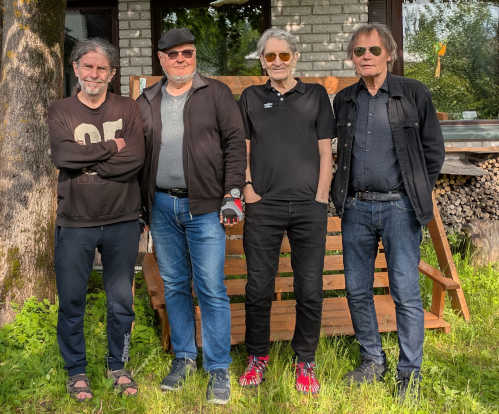

TLDR; Bändi lakkasi olemasta, soitto sen kuin vaan jatkuu.

> Aika aikaansa kutakin, sanoi pässi, kun päätä leikattiin.

Tämä oli yksi faijani lausahduksista, joka on jäänyt elämään minunkin käyttööni.

No joo, tähän bändin loppumiseen ei liity sen kummemmin dramatiikkaa, jossa esimerkiksi jäsenet tappelisivat keskenään ja eroaisivat sen vuoksi. Ei, tämä bändi vain hiipui pois. Toki aina jotain jännitteitä soittajien kesken on, niin oli meilläkin. Oltiin kuitenkin oikeasti "musiikkeriveljeksiä", kuten eräs soittokaverini ennen aina sanoi ollessaan bändissä. Tässä kokonpanossa oli suurimmillaan kolme kitaristia, kosketinsoittaja, basisti ja rumpali. Sittemmin ohensimme kokoonpanon kahteen kitaristiin, basistiin ja rumpaliin.

Kivaa kuitenkin oli, saatiin yksi EP-levykin aikaiseksi.  
[https://www.discogs.com/release/22579736-Stefan-Piesnack-Band-Crack-Killer](https://www.discogs.com/release/22579736-Stefan-Piesnack-Band-Crack-Killer)  
Kirjoittelinkin aiemmin studiotouhuista blogiin.

- [Studiossa, osa 1](https://teuvovaisanen.fi/2019/01/23/studiossa-osa-1/)

- [Studiossa, osa 2](https://teuvovaisanen.fi/2019/01/27/studiossa-osa-2/)

- [Studiossa, osa 3](https://teuvovaisanen.fi/2019/02/07/studiossa-osa-3/)

- [Studiossa, osa 4](https://teuvovaisanen.fi/2019/02/27/studiossa-osa-4/)

Studion lisäksi minä muutamaan otteeseen äänittelin omilla laitteillani biisejä ja osallistuttiin kerran mun äänityksellä [Syksyn Synkin Sävel -kisaan](https://teuvovaisanen.fi/2025/01/17/kilpailuun/).

<iframe
    loading="lazy"
    src="https://stedi.rocks/savages/embed/index.html"
    style="border: none; height: 49.6px; min-width: 480px;"
    title="Soitinwidgetti &quot;Savages&quot; kuunteluun">
</iframe>
Stedin äänitys ja miksaus Kari Kilpeläisen kappaleesta Savages.

Muutama keikkakin tuli tehtyä ja silloin tällöin käytyä open stage -paikoissa heittämässä biisejä. Helsingin Käpygrillin open stagella pääasiassa.

Tähän "muutamaan keikkaan" ehkä kiteytyykin bändin hiipuminen. Ei ollut tarpeeksi tavoitteita eikä keikkoja. Soittelimme pääosin treenikämpän seinille ja omille korvillemme. Se syö bändin ajan mittaan loppuun. Kukaan meistä ei ollut aktiivinen myyntimies, eikä keikkapaikat hae kotoa soittamaan.

 

Stefan Piesnack Band - 2025 treeniksen pihalla

Minä tulin basistiksi bändiin muistaakseni joskus vuonna 2018. Vajaa kymmenen vuotta siinä meni.

Pienet ovat kuitenkiin piirit, sillä olen soittanut osan tyypeistä kanssa jo ikuisuuden muissa kokoonpanoissa. Itse asiassa tämän bändin rungon muodosti entinen bändimme Slow Enough. Yhdessä vaiheessa rumpali Juha, basisti Teuvo, kosketinsoittaja Markku ja kitaristi Kari oli pohjana Piesnack-bändille. Lisänä olivat kitaristit Keijo ja Stefan. ;)

Yllä olevassa kuvassa Kari Kilpeläisen (1. vasemmalla) kanssa olen soitellut 25+ vuotta eri kokoonpanoissa, mm. Slow Enough. Rumpali Kaleva Raittisen (1. oikealla) kanssa soiteltiin mm. Double Trouble-bändissä jo 70-luvulla.

Stefan erkanee nyt tästä kokoonpanosta, mutta todennäköistä on, että me loput kolme, Kari, Kaleva ja Teuvo jatkamme soittoa ainakin omaksi iloksemme. Aika näyttää miten, ehkä hissukseen, olemmehan kaikki kolme 70+ vuotiaita, minä kolmikon kuopus.

Minulla on lisäksi soittotouhuja toisella treenikämpällä jamien sekä parin muun kokoonpanon puitteissa, siellä on aktiivisempaa touhua. Ja kotistudio. Soitto ei lopu, se jatkuu ja jatkuu ja jatkuu.
